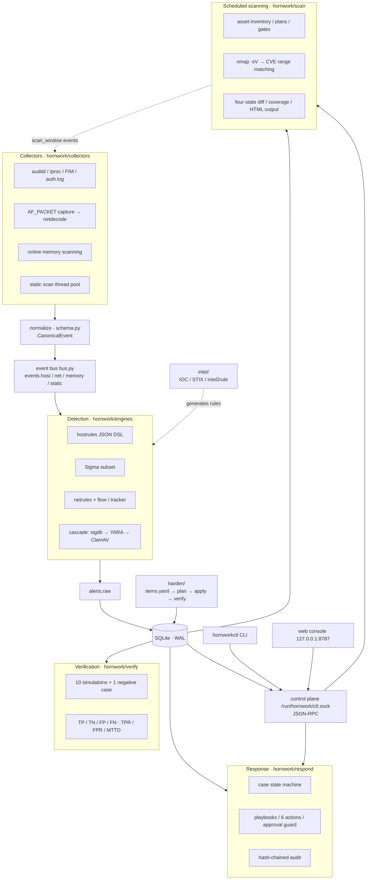

# Hornwork

**A single-process host and network defense-in-depth platform for Linux.** Collection, detection, response and verification in one loop — the only runtime dependencies beyond the Python standard library are libyara (via `yara-python`) and ClamAV.

[简体中文](README.md) | English


Hornwork (a *hornwork* is an early bastion-style fortification) puts the three layers that fail most often on a Linux box — host behaviour, network traffic and files landing on disk — into a single event pipeline, and keeps the evidence for every decision. It is deliberately small: one process, one SQLite database (WAL), one Unix-socket control plane. No frontend framework, no message broker, no distributed components.

The point is not how many log lines can be collected. It is two harder questions:

- **Can an alert be explained?** Every hit carries the engine name and version, rule id, evidence snippet and ATT&CK technique; every response action is appended to a hash-chained audit log that can be verified later.
- **Can a defense be verified?** Ten harmless ATT&CK attack simulations plus one negative case are judged inside time windows, producing TP/TN/FP/FN and recomputed TPR/FPR/MTTD.

External capabilities are always wired in as **separate processes or sockets** (`clamd`, `nmap`, `lynis`, `cryptsetup`). Hornwork orchestrates them and parses their output; it does not link, embed or redistribute their code.

## Contents

- [Features](#features)
- [Architecture](#architecture)
- [Getting started](#getting-started)
- [Capabilities and commands](#capabilities-and-commands)
- [Security model and secure defaults](#security-model-and-secure-defaults)
- [Reference benchmark](#reference-benchmark)
- [Repository layout](#repository-layout)
- [Documentation](#documentation)
- [Contributing](#contributing)
- [License and third-party components](#license-and-third-party-components)

## Features

| Layer | Capability | Where it lives |
|---|---|---|
| Host collection | auditd exec/identity/persistence events, `/proc` diffing and socket ownership, inotify file-integrity monitoring, `auth.log` brute-force detection | `hornwork/collectors/` |
| Network detection | AF_PACKET capture and protocol decoding, flow table + 5 s tracking window, 8-rule network DSL, IOC IP/domain egress matching | `collectors/netcap.py`, `engines/netrules.py` |
| Static scanning | sigdb (hash / hex / regex / entropy / ELF structure) → YARA → ClamAV cascade with hash cache, per-engine isolation and circuit breaking | `engines/cascade.py` |
| Behaviour detection | Sigma subset (`process_creation`, `file_event`, `network_connection`) and a JSON rule DSL for host events | `engines/sigma_matcher.py`, `engines/hostrules.py` |
| Memory | Online `maps`/`mem` scanning of suspicious regions, anonymous-RWX injection heuristic, snapshot re-checks, offline AVML/Vol3 cross-validation | `collectors/memscan.py`, `verify/forensics.py` |
| Threat intel | IOC import/aging/rule conversion (`intel2rule`), STIX 2.1 subset import and export | `hornwork/intel/` |
| Response | Case state machine, playbooks, 6 action types (quarantine file / kill process / block IP / isolate host / disable account / collect forensics), hash-chained audit | `hornwork/respond/` |
| Scheduled scanning | `nmap -sV` reused for port and service discovery; in-house CVE version-range matching, four-state snapshot diff, weighted coverage, self-contained HTML output | `hornwork/scan/` |
| Lab orchestration | Vulhub environment lifecycle, TTL, loopback-only port binding, out-of-scope rejection, reproduction and evidence capture | `hornwork/lab/`, `hornwork/vuln/` |
| Authentication | Argon2id passwords, in-house RFC 4226/6238 TOTP, revocable face templates with AES-256-GCM, risk-driven LOA2/LOA3 and step-up | `hornwork/auth/` |
| Hardening | 24-item / six-category baseline in `items.yaml`, signed `plan.json`, three-phase idempotent apply with rollback, before/after measurement | `hornwork/harden/` |
| Verification | 10 ATT&CK simulations + 1 negative case, time-window judging, TP/TN/FP/FN and TPR/FPR/MTTD | `hornwork/verify/` |
| Control plane | `hornworkctl` CLI, Unix-socket JSON-RPC, single-page web console on the standard library | `cli.py`, `ctl.py`, `web/` |

## Architecture



How the data plane maps onto a timeline:

1. **Collect** — collectors run on daemon threads and emit raw events, normalized into a `CanonicalEvent` (schema v1.0) and published on `events.<layer>`.
2. **Detect** — `hostrules` and `sigma` consume the event stream; the network path runs `netdecode → FlowTable/Tracker → NetRuleSet` on the capture hot path; files landing on disk enter the static scan cascade.
3. **Persist** — alerts are published on `alerts.raw`, deduplicated by `dedup_key` per rule, written to SQLite and linked to cases.
4. **Respond** — playbooks execute actions in `observe` / `dry-run` / `enforce` mode; every execution extends the audit chain.
5. **Scheduled work** — scans are triggered by `hornwork-scan@.timer` or the CLI; during a scan window a `scan_window` event tells the detection layer to downgrade only scan-related rules instead of switching detection off.

Design trade-offs worth knowing:

- **One process.** Collector threads, an asyncio bus and detection tasks share a single `hornwork.service`. One machine is enough to run, demo and debug the whole platform. Capacity is solved later by splitting topics across hosts, not by starting with a heavier architecture.
- **Drops are visible.** When a queue is full, items are dropped and counted; collectors never block. Drop counters show up in `status`, so "running" cannot silently mean "losing data".
- **Evidence before verdict.** Hits carry `engine`, rule id, offset/snippet and confidence; alerts carry `first_hit` and `contrib`, so "why did this fire" is answerable.
- **Reuse, don't embed.** `nmap`, `lynis`, `clamd` and `cryptsetup` are invoked as subprocesses or sockets and only their output is parsed — less brittle code, and a clean license boundary.
- **Observe by default.** Anything that could change the state of a protected host defaults to `observe`; real changes require explicit approval.

## Getting started

### Requirements

| Item | Requirement |
|---|---|
| OS | Linux x86_64 (developed and benchmarked on Ubuntu 24.04 / 26.04) |
| Python | 3.11+ (3.14 in the benchmark) |
| Privileges | root for installation and collection; the service itself runs as user `hornwork` |
| Required packages | `auditd`, `clamav-daemon`, `libyara-dev`, `iptables`, `attr`, `e2fsprogs` |
| Optional packages | `nmap` (required for scheduled scanning), `lynis` (host baseline measurement), `testssl.sh` / `nuclei` (optional evidence engines) |

### Install

```bash
git clone https://github.com/scientificmaniac/hornwork.git
cd hornwork
sudo bash scripts/setup.sh
```

`scripts/setup.sh` is idempotent. It installs apt dependencies, creates the venv at `/opt/hornwork-venv`, creates the service user and directories, installs the code to `/opt/hornwork`, loads auditd rules, patches the clamd fragment, installs the systemd unit and `/etc/hornwork/env` (web token, mode 0600), then starts `hornwork.service`.

The Makefile wraps the same steps:

```bash
make setup     # same as sudo bash scripts/setup.sh
make run       # run the daemon in the foreground (/opt/hornwork/config.toml)
make test      # unit tests
make check     # environment self-check
```

Paths after installation:

| Path | Content |
|---|---|
| `/opt/hornwork` | Code, rules, `config.toml` |
| `/opt/hornwork-venv` | Python virtualenv |
| `/etc/hornwork/env` | `HORNWORK_TOKEN` and other environment variables (0600, root) |
| `/var/lib/hornwork` | SQLite (WAL), quarantine, baselines, scan snapshots |
| `/var/log/hornwork` | Structured log `app.jsonl` |
| `/run/hornwork/ctl.sock` | Control-plane Unix socket (group `adm`, 0660) |
| `/etc/systemd/system/hornwork.service` | Main service unit |
| `deploy/hornwork-scan@.service` and `.timer` | Scheduled-scan templates, instantiated per plan |

### Self-check

```bash
sudo bash scripts/check.sh
```

It checks the service, `yara`/`PyYAML` versions, clamd `PING`, the number of loaded auditd rules, NTP, disk headroom, `ctl.sock`, SQLite and the web `/healthz` endpoint. Exit code is 0 only when everything passes.

### Common commands

```bash
# Status and queries
hornworkctl status
hornworkctl events --since 10m --type process_create
hornworkctl alerts --since 24h --level 8
hornworkctl alerts --since 1h --technique T1105

# Rules and threat intel
hornworkctl rules reload
hornworkctl rules list
hornworkctl intel import rules/ioc/sample-ips.jsonl
hornworkctl intel build --bundle bundle-1

# Files and memory
hornworkctl scan file /tmp/sample.bin --deep
hornworkctl mem scan --pid 1234 --snapshot
hornworkctl mem verify --snapshot /opt/hornwork/raw/mem/<host>-<ts>

# Cases and response (observe by default, nothing is changed)
hornworkctl case list --status open
hornworkctl respond --case <case_id> --playbook PB-001 --mode dry-run

# Verification and audit
hornworkctl verify run --suite baseline
hornworkctl audit verify
```

### Web console

```bash
TOKEN=$(sudo grep -oP '(?<=^HORNWORK_TOKEN=).*' /etc/hornwork/env)
curl -s -H "Authorization: Bearer $TOKEN" http://127.0.0.1:8787/api/overview
```

The console binds to `127.0.0.1:8787` only. The static page and `/healthz` are reachable without a token so the page can be opened before entering one; `/api/*` and `/metrics` require `Authorization: Bearer <token>`, and so do write operations (rule reload, IOC import, case creation). Views cover overview, events, alerts, rules, intel, cases, verification, engine contribution, scanning and authentication.

### One-command walkthrough

```bash
sudo bash scripts/demo.sh
```

Rule reload → local HTTP serving an EICAR test string → FIM and cascade hits → alert and case → verification suite → export. No external network access; about one minute.

## Capabilities and commands

| Capability | Command | Notes |
|---|---|---|
| Runtime status | `hornworkctl status` | Collectors, engines, bus metrics and counters |
| Events | `hornworkctl events --since 1h --type file_create` | `--layer` filters `host`/`net`/`memory`/`static` |
| Alerts | `hornworkctl alerts --since 24h --technique T1105` | `--level` filters by severity level |
| File scan | `hornworkctl scan file <path> [--deep]` | sigdb→YARA→ClamAV cascade; ClamAV only with `--deep` |
| Memory scan | `hornworkctl mem scan --pid <pid>` / `hornworkctl mem verify --snapshot <dir>` | Suspicious regions + injection heuristic; snapshots are re-checkable |
| Rules | `hornworkctl rules reload` / `hornworkctl rules list` | Hot reload for YARA, network, host, Sigma and sigdb |
| Threat intel | `hornworkctl intel import <path>` / `intel build` / `intel list` | Import, convert to rules, list by type |
| Cases | `hornworkctl case list` / `case show <id>` / `case create --alert <id>` | State machine: open → investigating → contained → closed |
| Response | `hornworkctl respond --case <id> --playbook PB-001 --mode observe\|dry-run\|enforce` | 6 action types; `enforce` needs approval |
| Verification | `hornworkctl verify run --suite baseline [--no-execute]` | Runs the 10+1 cases and computes TPR/FPR/MTTD |
| Audit chain | `hornworkctl audit verify` | Detects a broken `action_audit` hash chain |
| Forensics | `hornworkctl forensics collect` / `analyze --image ` / `compare` | AVML capture, Vol3 analysis, online/offline cross-check |
| Asset inventory | `hornworkctl asset add --ip <ip> --role server` / `asset list` | The only source of scan targets |
| Scan plans | `hornworkctl scan plan add --id weekly-linux --profile weekly` / `scan plan list` | Schedules are data; the timer is just an alarm clock |
| Run a scan | `hornworkctl scan run --plan weekly-linux`, or `scan run --profile quick` | Same entry point as the timer; `--force-window` overrides the window |
| Findings | `hornworkctl scan findings --severity 高` / `scan finding set --id <id> --status <s>` | Severity labels: 严重 / 高 / 中 / 低 / 无 |
| Differences and coverage | `hornworkctl scan diff --from <snap> --to <snap>` / `scan coverage` | Four states: new / fixed / still present / regressed |
| Scan output | `hornworkctl scan report --format html\|json --out <dir>` | Self-contained single-file HTML with evidence and confidence |
| CVE data | `hornworkctl scan cve import --source nvd --dir <dir>` / `scan cve stats\|map` | NVD 2.0 and Ubuntu OVAL cached offline |
| Lab environments | `hornworkctl lab index\|list\|up\|down\|status\|logs\|isolate` | Vulhub lifecycle, loopback-only ports |
| Vulnerability records | `hornworkctl vuln record sync` / `vuln list\|show\|match\|report` | CVSS 3.1, version-range matching, remediation export |
| Authentication | `hornworkctl auth db init` / `auth user add` / `auth otp enroll` / `auth login` / `auth step-up` | See [docs/authentication.md](docs/authentication.md) |
| Hardening | `python -m hornwork.harden plan\|check\|apply\|verify\|rollback` | Separate entry point, decoupled from the main CLI; see [docs/hardening.md](docs/hardening.md) |
| Export and pruning | `hornworkctl export --format md\|jsonl` / `hornworkctl prune --days 30` | Export events/alerts, prune history |

## Security model and secure defaults

The platform assumes it may itself be attacked, so the defaults favour having no side effects:

| Control | Default | Details |
|---|---|---|
| Response mode | `observe` | Records and audits only; `dry-run` prints the commands that would run |
| `enforce` approval | Explicit approval required | `HORNWORK_APPROVED=1`, or `respond.allow_enforce=true`; otherwise every request is refused |
| Service identity | `hornwork` user with minimal capabilities | Only `CAP_NET_RAW`, `CAP_NET_ADMIN`, `CAP_SYS_PTRACE`; `NoNewPrivileges=yes`, `ProtectSystem=strict`, `PrivateTmp` disabled where FIM needs the host `/tmp` |
| Control plane | Unix socket, mode 0660, group `adm` | Local only; no listening port |
| Web console | `127.0.0.1:8787` only | Bearer token in `/etc/hornwork/env` (0600, root) |
| Rules directory | Writable only by `hornwork` | Stops rule replacement from silently becoming an allow-list |
| Scan scope | `scan.allow_cidrs` allow-list | Loopback and local addresses only; anything else is rejected and audited |
| Lab ports | Bound to `127.0.0.1`, range 18000–18999 | TTL-based teardown; `lab down` removes volumes |
| Audit | Hash chain in `action_audit` | `hash = sha256(prev_hash + normalized fields)` per action; verifiable offline |

A few boundaries are intentional:

- **Data stays local by default.** SQLite is the only store: intel, CVE caches and scan snapshots live on the host. The platform does not reach out except when installing dependencies or explicitly importing external data.
- **Downgrade, don't disable.** Inside a scan window only scan-related rules (`N-0101`, `N-0102`, `N-0104`, `N-0105`) are suppressed, and every suppression is counted — no "quiet the noise by turning detection off".
- **Explainability over auto-remediation.** Every alert carries evidence and an ATT&CK technique; automated response advises by default, and real changes need a human decision.
- **Use it against your own or authorized assets only.** Packet capture, port scanning and lab orchestration are real capabilities; do not point them at systems you do not own or administer.

## Reference benchmark

Measured by the maintainers on a **4 vCPU / 8 GB Ubuntu 26.04 LTS test host with Python 3.14**. Values indicate order of magnitude, not a performance promise:

| Metric | Result |
|---|---|
| Environment self-check `scripts/check.sh` | 15/15 passed |
| Verification suite (first run on a clean database) | TP=10 TN=1 FP=0 FN=0, TPR=1.0, FPR=0.0, MTTD ≈ 0.5 s |
| Rule loading | 13 YARA rules, 8 network rules, 8 host rules, 66 Sigma rules (65 supported / 1 unsupported) |
| One full `scripts/demo.sh` run | ≈ 60 s, ≈ 950 events, ≈ 132 alerts |
| Scheduled scan, weekly profile | 214 findings, 329 s, weighted coverage 89.7% |
| Scheduled scan, quick profile | 8.1 s |
| CVE version-range matching (20 hand-labelled samples) | TP=10 TN=10 FP=0 FN=0 |
| Hardening run | 24/24 completed; second run 24/24 idempotent; Lynis index 66 → 72 |
| Authentication | LOA2 login P50 ≈ 73 ms |

Code size: 112 Python files and roughly 35k lines under `hornwork/`; about 8.8k lines in `tests/` with 515 unittest cases (root-only or Linux-specific cases skip automatically on unprivileged hosts).

## Repository layout

```text
hornwork/
├── hornwork/            # platform code
│   ├── daemon.py        # wiring: collectors / engines / bus / store / control plane / web
│   ├── bus.py           # async event bus (backpressure, drop counters, DLQ)
│   ├── schema.py        # CanonicalEvent / DetectionAlert / validation
│   ├── store.py         # SQLite (WAL) access layer and all DDL
│   ├── config.py        # TOML config and defaults
│   ├── ctl.py           # control-plane Unix-socket JSON-RPC
│   ├── cli.py           # hornworkctl command line
│   ├── collectors/      # auditd, proc, fim, authlog, netcap, memscan
│   ├── engines/         # sigdb, yara, clamd, cascade, hostrules, sigma, netflow, netrules
│   ├── intel/           # IOC store, feeds, intel2rule, STIX 2.1 subset
│   ├── respond/         # cases, playbooks, actions, approval guard, audit chain
│   ├── verify/          # runner, judge, metrics, forensics, simulation scripts
│   ├── scan/            # inventory, plans and gates, nmap adapter, CVE matching, snapshots, coverage, HTML output
│   ├── lab/             # Vulhub orchestration (local / SSH backends)
│   ├── vuln/            # vulnerability records, CVSS 3.1, version-range matching
│   ├── auth/            # Argon2id, TOTP, face templates, risk and LOA, sessions
│   ├── harden/          # baseline, plans, idempotent apply and rollback
│   └── web/             # single-page web console on http.server
├── rules/               # yara/ net/ host/ sigma/ sigdb/ ioc/ playbooks/ scan/ nuclei/
├── deploy/              # systemd units, auditd rules, clamd fragment, logrotate
├── scripts/             # setup.sh / check.sh / demo.sh
├── tests/               # unittest
├── docs/                # design and operations documentation
├── data/                # demo data, record templates, Vulhub index
├── config.toml          # default configuration (commented)
├── pyproject.toml
└── Makefile
```

## Documentation

| Document | Content |
|---|---|
| [docs/architecture.md](docs/architecture.md) | Overall architecture, process and thread model, data flow, trade-offs |
| [docs/interfaces.md](docs/interfaces.md) | Event/alert schema, SQLite tables, control-plane and HTTP APIs |
| [docs/rules.md](docs/rules.md) | YARA / network DSL / host JSON / Sigma subset / IOC formats |
| [docs/lab.md](docs/lab.md) | Lab orchestration, vulnerability records, CVSS 3.1 and version-range matching |
| [docs/scanning.md](docs/scanning.md) | Scheduled scanning: inventory, plans, gates, CVE matching, snapshots, coverage |
| [docs/authentication.md](docs/authentication.md) | Three-factor authentication, crypto usage, risk and LOA, boundaries |
| [docs/hardening.md](docs/hardening.md) | Hardening orchestration, baseline, idempotent apply and rollback, measurement |
| [docs/verification.md](docs/verification.md) | Verification methodology, metric definitions, adding new cases |
| [docs/runbook.md](docs/runbook.md) | Install, start/stop, troubleshooting, backup and restore |
| [docs/development.md](docs/development.md) | Development environment, tests, extension points, commit conventions |
| [docs/CONTRACT.md](docs/CONTRACT.md) | Internal interface contract (the single source of truth for interfaces) |

## Contributing

- Contribution workflow, code style, how to add detection rules and playbooks: [CONTRIBUTING.md](CONTRIBUTING.md)
- For security issues please do not open a public issue; follow the private channel described in [SECURITY.md](SECURITY.md)
- Changelog: [CHANGELOG.md](CHANGELOG.md)
- Local development:

```bash
python -m venv .venv && . .venv/bin/activate
pip install -e .
python -m compileall -q hornwork
python -m unittest discover -s tests -v
```

## License and third-party components

Hornwork is released under **Apache-2.0**; the full text is in `LICENSE` at the repository root.

| Component | License | How it is used |
|---|---|---|
| libyara / `yara-python` | BSD-3-Clause / Apache-2.0 | libyara is linked in-process and called through the `yara-python` bindings |
| ClamAV (`clamd`) | GPL-2.0 | Separate process reached over a Unix socket with `INSTREAM`; not linked, not redistributed |
| Sigma rules | Detection Rule License 1.1 | Rule data from SigmaHQ, see `rules/sigma/NOTICE.md` |
| `nmap` | GPL-2.0 / NPSL | Separate process (`nmap -sV`); only its XML output is parsed |
| Lynis | GPL-3.0 | Separate process; only its output is parsed |
| PyYAML | MIT | Python dependency (configuration and Sigma rule parsing) |
| OpenSSL 3 | Apache-2.0 | Command-line invocation (local CA, TLS probing and validation) |
| nginx | BSD-2-Clause | Only as a hardened/observed target; its code is not modified |
| `cryptsetup` | GPL-2.0 | Subprocess calls (LUKS2 key slots and KDF) |
| `argon2-cffi` | MIT | Python dependency (Argon2id password hashing) |

**License boundary**: every GPL component is integrated as a separate process, command-line tool or socket. Hornwork does not link, embed or redistribute their code, so no copyleft obligation reaches this project's source. Sigma rules are governed by DRL 1.1 and remain replaceable rule data rather than program code. NVD CVE and Ubuntu OVAL data are cached locally at import time; copyright and terms remain with their sources and the data is not redistributed here.
