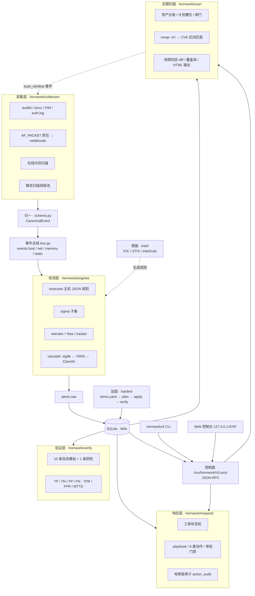

# Hornwork

**单进程的 Linux 主机与网络纵深防御平台**——采集、检测、响应、验证形成闭环，除 Python 标准库外只依赖 libyara（`yara-python`）与 ClamAV。

简体中文 | [English](README.en.md)


Hornwork（棱堡，早期军事防御工事）把一台 Linux 主机上最容易失守的三层——主机行为、网络流量、落地文件——放进同一条事件流水线，并为每一次判定留下可追溯的证据。它刻意做减法：一个进程、一个 SQLite（WAL）、一条 Unix socket 控制面；没有前端框架，没有消息中间件，也没有分布式组件。

平台的落脚点不是"采到了多少日志"，而是两件更难的事：

- **一条告警能否被解释**：每个命中都带引擎名与版本、规则号、证据片段、ATT&CK 技术号；每次响应动作都追加到哈希链审计里，事后可校验。
- **一次防御能否被验证**：内置 10 条无害的 ATT&CK 攻击模拟 + 1 条阴性用例，按时间窗自动判定 TP/TN/FP/FN，可重复算出 TPR/FPR/MTTD。

外部能力一律以**独立进程或 socket** 接入（`clamd`、`nmap`、`lynis`、`cryptsetup`），Hornwork 只编排与解析输出，不链接、不内嵌第三方代码。

## 目录

- [核心特性](#核心特性)
- [架构](#架构)
- [快速开始](#快速开始)
- [能力与命令对照](#能力与命令对照)
- [安全模型与默认安全](#安全模型与默认安全)
- [参考基准](#参考基准)
- [仓库结构](#仓库结构)
- [文档](#文档)
- [参与贡献](#参与贡献)
- [许可证与第三方组件](#许可证与第三方组件)

## 核心特性

| 层面 | 能力 | 关键实现 |
|---|---|---|
| 主机采集 | auditd 的 exec/身份/持久化事件、`/proc` 差分与连接表、inotify 文件完整性监控、`auth.log` 暴力破解识别 | `hornwork/collectors/` |
| 网络检测 | AF_PACKET 抓包与协议解码、flow 表 + 5 s 追踪窗口、8 条网络规则 DSL、情报 IP/域名出站匹配 | `collectors/netcap.py`、`engines/netrules.py` |
| 静态检测 | sigdb（哈希 / hex / 正则 / 熵 / ELF 结构）→ YARA → ClamAV 三级级联，哈希缓存、单引擎失败隔离与熔断 | `engines/cascade.py` |
| 行为检测 | Sigma 子集（`process_creation` / `file_event` / `network_connection`）与主机 JSON 规则 DSL | `engines/sigma_matcher.py`、`engines/hostrules.py` |
| 内存 | 在线 `maps`/`mem` 可疑段扫描、匿名 RWX 与连接窗口的注入判定、快照复核、离线 AVML/Vol3 互证 | `collectors/memscan.py`、`verify/forensics.py` |
| 情报 | IOC 导入/老化/回灌规则（intel2rule）、STIX 2.1 子集导入导出 | `hornwork/intel/` |
| 响应 | 工单状态机、playbook、6 类动作（隔离文件 / 杀进程 / 封 IP / 隔离主机 / 禁用账号 / 取证收集）、哈希链审计 | `hornwork/respond/` |
| 定期漏洞扫描 | 复用 `nmap -sV` 做端口与服务发现，自研 CVE 版本区间匹配、快照四态 diff、加权覆盖率、自包含 HTML 输出 | `hornwork/scan/` |
| 靶场编排 | Vulhub 环境生命周期、TTL、回环端口绑定、越界拒绝、复现与证据采集 | `hornwork/lab/`、`hornwork/vuln/` |
| 认证 | Argon2id 口令、自研 RFC 4226/6238 TOTP、可撤销人脸模板 + AES-256-GCM、风险驱动 LOA2/LOA3 与 step-up | `hornwork/auth/` |
| 加固编排 | `items.yaml` 24 项六类基线、带签名的 `plan.json`、三段式幂等执行与回滚、加固前后客观测量 | `hornwork/harden/` |
| 验证 | 10 条 ATT&CK 模拟 + 1 条阴性、时间窗判定、TP/TN/FP/FN 与 TPR/FPR/MTTD | `hornwork/verify/` |
| 控制面 | `hornworkctl` CLI、Unix socket JSON-RPC、标准库单页 Web 控制台 | `cli.py`、`ctl.py`、`web/` |

## 架构



数据面与时间线的对应关系：

1. **采集**：各采集器在守护线程里产出原始事件，统一归一为 `CanonicalEvent`（schema v1.0），按 `events.<layer>` 投递到总线；
2. **检测**：`hostrules`、`sigma` 消费事件流；网络侧由 `netdecode → FlowTable/Tracker → NetRuleSet` 在抓包热路径上判定；文件落盘时进入级联静态扫描；
3. **落库**：告警统一发到 `alerts.raw`，守护进程做同规则去重（`dedup_key`）后写 SQLite，并联动工单；
4. **响应**：按 playbook 执行动作，`observe`/`dry-run`/`enforce` 三档，每次执行追加审计链；
5. **周期任务**：定期扫描由 `hornwork-scan@.timer` 或 CLI 触发，扫描期间向总线发 `scan_window` 事件，让检测层只降级自扫流量相关规则，而不是关规则。

关键设计取舍：

- **单进程**：采集线程 + asyncio 总线 + 检测协程同处一个 `hornwork.service`，一台机器即可完整运行、演示与排错；容量上限用"按话题拆分部署"解决，而不是先把架构做重。
- **丢弃可见**：队列满时丢弃并计数，采集线程永不阻塞；丢弃数进入 `status` 输出，避免"看起来在跑，其实在丢"。
- **证据先于结论**：命中带 `engine`、规则号、offset/片段与置信度；告警带 `first_hit`、`contrib`，能回答"为什么报它"。
- **复用而不内嵌**：`nmap`、`lynis`、`clamd`、`cryptsetup` 以子进程或 socket 调用，只解析输出——既少写脆弱代码，也让许可边界保持干净。
- **默认观测**：可能改变被保护主机状态的动作默认 `observe`；要动真格必须显式审批。

## 快速开始

### 环境要求

| 项 | 要求 |
|---|---|
| 系统 | Linux x86_64（开发与实测：Ubuntu 24.04 / 26.04） |
| Python | 3.11+（实测 3.14） |
| 权限 | 安装与采集需要 root；服务本身以 `hornwork` 用户运行 |
| 必需组件 | `auditd`、`clamav-daemon`、`libyara-dev`、`iptables`、`attr`、`e2fsprogs` |
| 可选组件 | `nmap`（定期扫描必需）、`lynis`（主机基线测量）、`testssl.sh` / `nuclei`（可选证据引擎） |

### 安装

```bash
git clone https://github.com/hornwork/hornwork.git
cd hornwork
sudo bash scripts/setup.sh
```

`scripts/setup.sh` 是幂等的，按顺序完成：apt 依赖 → Python venv（`/opt/hornwork-venv`）→ 系统用户与目录 → 安装代码到 `/opt/hornwork` → auditd 规则 → clamd 片段 → systemd 单元与 `/etc/hornwork/env`（Web token，0600）→ 启动 `hornwork.service`。

也可以用 Makefile：

```bash
make setup     # 等价于 sudo bash scripts/setup.sh
make run       # 前台运行 daemon（读 /opt/hornwork/config.toml）
make test      # 单元测试
make check     # 环境自检
```

安装后的路径约定：

| 路径 | 内容 |
|---|---|
| `/opt/hornwork` | 程序、规则、`config.toml` |
| `/opt/hornwork-venv` | Python 虚拟环境 |
| `/etc/hornwork/env` | `HORNWORK_TOKEN` 等环境变量（0600，root） |
| `/var/lib/hornwork` | SQLite（WAL）、隔离区、基线、扫描快照 |
| `/var/log/hornwork` | 结构化日志 `app.jsonl` |
| `/run/hornwork/ctl.sock` | 控制面 Unix socket（组 `adm`，0660） |
| `/etc/systemd/system/hornwork.service` | 主服务单元 |
| `deploy/hornwork-scan@.service` 与 `.timer` | 定期扫描模板，按计划实例化 |

### 自检

```bash
sudo bash scripts/check.sh
```

逐项检查服务状态、`yara`/`PyYAML` 版本、clamd `PING`、auditd 规则条数、NTP、磁盘、`ctl.sock`、SQLite、Web `/healthz`；全部通过时退出码为 0。

### 常用命令

```bash
# 运行状态与查询
hornworkctl status
hornworkctl events --since 10m --type process_create
hornworkctl alerts --since 24h --level 8
hornworkctl alerts --since 1h --technique T1105

# 规则与情报
hornworkctl rules reload
hornworkctl rules list
hornworkctl intel import rules/ioc/sample-ips.jsonl
hornworkctl intel build --bundle bundle-1

# 文件 / 内存
hornworkctl scan file /tmp/sample.bin --deep
hornworkctl mem scan --pid 1234 --snapshot
hornworkctl mem verify --snapshot /opt/hornwork/raw/mem/<host>-<ts>

# 工单与响应（默认 observe，不改系统）
hornworkctl case list --status open
hornworkctl respond --case <case_id> --playbook PB-001 --mode dry-run

# 验证与审计
hornworkctl verify run --suite baseline
hornworkctl audit verify
```

### Web 控制台

```bash
TOKEN=$(sudo grep -oP '(?<=^HORNWORK_TOKEN=).*' /etc/hornwork/env)
curl -s -H "Authorization: Bearer $TOKEN" http://127.0.0.1:8787/api/overview
```

控制台只绑定 `127.0.0.1:8787`。静态页面与 `/healthz` 可先打开（便于填写 token），`/api/*` 与 `/metrics` 需要 `Authorization: Bearer <token>`；写操作（规则热加载、IOC 导入、建单）同样受 token 保护。单页视图覆盖概览、事件、告警、规则、情报、工单、验证、引擎贡献、扫描与认证。

### 一条命令跑通全流程

```bash
sudo bash scripts/demo.sh
```

规则热加载 → 本地 HTTP 提供 EICAR 测试串 → FIM 与级联扫描命中 → 告警与工单 → 验证套件 → 导出。全程不访问外网，约 1 分钟。

## 能力与命令对照

| 能力 | 命令 | 说明 |
|---|---|---|
| 运行状态 | `hornworkctl status` | 采集器、引擎、总线指标与各类计数 |
| 事件查询 | `hornworkctl events --since 1h --type file_create` | `--layer` 按 `host/net/memory/static` 过滤 |
| 告警查询 | `hornworkctl alerts --since 24h --technique T1105` | `--level` 按级别过滤 |
| 文件扫描 | `hornworkctl scan file <path> [--deep]` | 级联 sigdb→YARA→ClamAV；`--deep` 才调 ClamAV |
| 内存扫描 | `hornworkctl mem scan --pid <pid>` / `hornworkctl mem verify --snapshot <dir>` | 可疑段 + 注入判定；快照可复核 |
| 规则管理 | `hornworkctl rules reload` / `hornworkctl rules list` | YARA / 网络 / 主机 / Sigma / sigdb 热加载 |
| 情报 | `hornworkctl intel import <path>` / `intel build` / `intel list` | 导入、回灌为规则、按类型列举 |
| 工单 | `hornworkctl case list` / `case show <id>` / `case create --alert <id>` | 状态机 open → investigating → contained → closed |
| 响应 | `hornworkctl respond --case <id> --playbook PB-001 --mode observe\|dry-run\|enforce` | 6 类动作，`enforce` 需审批 |
| 验证 | `hornworkctl verify run --suite baseline [--no-execute]` | 执行 10+1 用例并算 TPR/FPR/MTTD |
| 审计链 | `hornworkctl audit verify` | 校验 `action_audit` 哈希链是否断链 |
| 取证 | `hornworkctl forensics collect` / `analyze --image ` / `compare` | AVML 采集、Vol3 分析、在线/离线互证 |
| 资产台账 | `hornworkctl asset add --ip <ip> --role server` / `asset list` | 扫描目标的唯一来源 |
| 扫描计划 | `hornworkctl scan plan add --id weekly-linux --profile weekly` / `scan plan list` | 周期是数据，timer 只是闹钟 |
| 执行扫描 | `hornworkctl scan run --plan weekly-linux`，或 `scan run --profile quick` | 与 timer 同一入口；`--force-window` 可越时间窗 |
| Finding | `hornworkctl scan findings --severity 高` / `scan finding set --id <id> --status <s>` | 严重级：严重/高/中/低/无 |
| 差异与覆盖率 | `hornworkctl scan diff --from <snap> --to <snap>` / `scan coverage` | 四态：新增/已修复/仍存在/回归 |
| 扫描输出 | `hornworkctl scan report --format html\|json --out <dir>` | 自包含单文件 HTML，含证据与置信度 |
| CVE 数据 | `hornworkctl scan cve import --source nvd --dir <dir>` / `scan cve stats\|map` | NVD 2.0 与 Ubuntu OVAL 离线缓存 |
| 靶场 | `hornworkctl lab index\|list\|up\|down\|status\|logs\|isolate` | Vulhub 环境生命周期，端口只绑回环 |
| 漏洞档案 | `hornworkctl vuln record sync` / `vuln list\|show\|match\|report` | CVSS 3.1、版本区间匹配、整改单导出 |
| 认证 | `hornworkctl auth db init` / `auth user add` / `auth otp enroll` / `auth login` / `auth step-up` | 见 [docs/authentication.md](docs/authentication.md) |
| 加固编排 | `python -m hornwork.harden plan\|check\|apply\|verify\|rollback` | 与主 CLI 解耦的独立入口，见 [docs/hardening.md](docs/hardening.md) |
| 导出与清理 | `hornworkctl export --format md\|jsonl` / `hornworkctl prune --days 30` | 导出事件/告警，清理历史数据 |

## 安全模型与默认安全

平台自身按"可能被攻击"来设计，默认配置偏向不产生副作用：

| 控制点 | 默认行为 | 说明 |
|---|---|---|
| 响应动作模式 | `observe` | 只记录与审计，不改系统；`dry-run` 打印将执行的命令 |
| `enforce` 审批 | 需显式审批 | 环境变量 `HORNWORK_APPROVED=1`，或配置 `respond.allow_enforce=true`，否则一律拒绝 |
| 服务身份 | `hornwork` 用户 + 最小 capability | 仅 `CAP_NET_RAW`、`CAP_NET_ADMIN`、`CAP_SYS_PTRACE`；`NoNewPrivileges=yes`、`ProtectSystem=strict`、`PrivateTmp` 按需关闭 |
| 控制面 | Unix socket `0660`，组 `adm` | 只在本机，不开监听端口 |
| Web 控制台 | 仅 `127.0.0.1:8787` | Bearer token 存于 `/etc/hornwork/env`（0600，root） |
| 规则目录 | 仅 `hornwork` 可写 | 防止规则被替换后静默放行 |
| 扫描范围 | `scan.allow_cidrs` 白名单 | 只允许回环与本机地址；越界目标直接拒绝并写审计 |
| 靶场端口 | 只绑 `127.0.0.1`，端口段 18000–18999 | TTL 到期回收，`lab down` 清理数据卷 |
| 审计 | 哈希链 `action_audit` | 每次动作追加（`hash = sha256(prev_hash + 规范化字段)`），可离线校验 |

几条刻意保留的边界：

- **数据默认留在本机**：SQLite 是唯一存储，情报、CVE 缓存、扫描快照都在本地；除安装依赖与显式导入外部数据外不主动外联。
- **降级而不是关规则**：扫描窗口内只对扫描类规则（`N-0101`、`N-0102`、`N-0104`、`N-0105`）做抑制并计数，避免"为了不吵就把检测关掉"。
- **可解释优先于自动处置**：每个告警带证据链与 ATT&CK 编号；自动处置默认只做"建议"，真实执行需要人审批。
- **只对自有或已授权资产使用**：抓包、端口扫描、靶场编排都具备真实能力，请勿指向不属于你的目标。

## 参考基准

以下为维护者在一台 **4 vCPU / 8 GB、Ubuntu 26.04 LTS、Python 3.14** 的测试主机上的实测值，用于说明量级，不构成性能承诺：

| 项 | 实测结果 |
|---|---|
| 环境自检 `scripts/check.sh` | 15/15 通过 |
| 验证套件（干净库首次运行） | TP=10 TN=1 FP=0 FN=0，TPR=1.0，FPR=0.0，MTTD ≈ 0.5 s |
| 规则加载 | YARA 13 条、网络 8 条、主机 8 条、Sigma 66 条（65 supported / 1 unsupported） |
| 一次 `scripts/demo.sh` 全流程 | 约 60 s，事件约 950 条、告警约 132 条 |
| 定期扫描 weekly 一轮 | 214 条 finding，耗时 329 s，加权覆盖率 89.7% |
| 定期扫描 quick 一轮 | 8.1 s |
| CVE 版本区间匹配（20 条人工标注样本） | TP=10 TN=10 FP=0 FN=0 |
| 加固编排 | 24/24 完成；二次执行 24/24 幂等；Lynis 指数 66 → 72 |
| 认证 | LOA2 登录 P50 ≈ 73 ms |

代码规模：`hornwork/` 下 112 个 Python 文件、约 3.5 万行；`tests/` 约 8800 行、515 个 unittest 用例（依赖 root 或 Linux 专属能力的用例在非特权环境自动跳过）。

## 仓库结构

```text
hornwork/
├── hornwork/            # 平台代码
│   ├── daemon.py        # 装配：采集器 / 引擎 / 总线 / 存储 / 控制面 / Web
│   ├── bus.py           # 异步事件总线（背压、丢弃计数、死信）
│   ├── schema.py        # CanonicalEvent / DetectionAlert / 校验
│   ├── store.py         # SQLite(WAL) 访问层与全部 DDL
│   ├── config.py        # TOML 配置与默认值
│   ├── ctl.py           # 控制面 Unix socket JSON-RPC
│   ├── cli.py           # hornworkctl 命令行
│   ├── collectors/      # auditd、proc、fim、authlog、netcap、memscan
│   ├── engines/         # sigdb、yara、clamd、cascade、hostrules、sigma、netflow、netrules
│   ├── intel/           # IOC 库、订阅源、intel2rule、STIX 2.1 子集
│   ├── respond/         # 工单、playbook、动作、审批门禁、审计链
│   ├── verify/          # 运行器、判定器、指标、取证互证、模拟脚本
│   ├── scan/            # 台账、计划与闸门、nmap 适配、CVE 匹配、快照、覆盖率、HTML 输出
│   ├── lab/             # Vulhub 编排（本地 / SSH 后端）
│   ├── vuln/            # 漏洞档案、CVSS 3.1、版本区间匹配
│   ├── auth/            # Argon2id、TOTP、人脸模板、风险与 LOA、会话
│   ├── harden/          # 基线、计划、幂等执行与回滚
│   └── web/             # 标准库 HTTP 单页控制台
├── rules/               # yara/ net/ host/ sigma/ sigdb/ ioc/ playbooks/ scan/ nuclei/
├── deploy/              # systemd 单元、auditd 规则、clamd 片段、logrotate
├── scripts/             # setup.sh / check.sh / demo.sh
├── tests/               # unittest
├── docs/                # 设计与运维文档
├── data/                # 演示数据、档案模板、Vulhub 索引
├── config.toml          # 默认配置（带注释）
├── pyproject.toml
└── Makefile
```

## 文档

| 文档 | 内容 |
|---|---|
| [docs/architecture.md](docs/architecture.md) | 总体架构、进程与线程模型、数据流、关键设计取舍 |
| [docs/interfaces.md](docs/interfaces.md) | 事件/告警 schema、SQLite 表、控制面与 HTTP API |
| [docs/rules.md](docs/rules.md) | YARA / 网络 DSL / 主机 JSON / Sigma 子集 / IOC 格式 |
| [docs/lab.md](docs/lab.md) | 靶场编排、漏洞档案、CVSS 3.1 与版本区间匹配 |
| [docs/scanning.md](docs/scanning.md) | 定期扫描：台账、计划、闸门、CVE 匹配、快照、覆盖率 |
| [docs/authentication.md](docs/authentication.md) | 三因子认证、密码算法落点、风险与 LOA、边界 |
| [docs/hardening.md](docs/hardening.md) | 加固编排、基线、幂等执行与回滚、前后测量 |
| [docs/verification.md](docs/verification.md) | 验证方法论、指标定义、如何新增用例 |
| [docs/runbook.md](docs/runbook.md) | 安装、启停、排错、备份与恢复 |
| [docs/development.md](docs/development.md) | 开发环境、测试、扩展点与提交约定 |
| [docs/CONTRACT.md](docs/CONTRACT.md) | 内部接口契约（开发用，接口的唯一依据） |

## 参与贡献

- 贡献流程、代码风格、如何新增检测规则与 playbook：[CONTRIBUTING.md](CONTRIBUTING.md)
- 安全问题请勿公开提交 issue，按 [SECURITY.md](SECURITY.md) 的渠道私密反馈
- 变更记录：[CHANGELOG.md](CHANGELOG.md)
- 开发环境与跑测试：

```bash
python -m venv .venv && . .venv/bin/activate
pip install -e .
python -m compileall -q hornwork
python -m unittest discover -s tests -v
```

## 许可证与第三方组件

Hornwork 以 **Apache-2.0** 发布，全文见仓库根目录的 `LICENSE`。

| 组件 | 许可 | 集成方式 |
|---|---|---|
| libyara / `yara-python` | BSD-3-Clause / Apache-2.0 | 进程内链接 libyara，经 `yara-python` 绑定调用 |
| ClamAV（`clamd`） | GPL-2.0 | 独立进程 + Unix socket `INSTREAM`，不链接、不分发 |
| Sigma 规则 | Detection Rule License 1.1 | 规则文本，来源 SigmaHQ，见 `rules/sigma/NOTICE.md` |
| `nmap` | GPL-2.0 / NPSL | 独立进程 `nmap -sV`，仅解析 XML 输出 |
| Lynis | GPL-3.0 | 独立进程，仅解析其输出 |
| PyYAML | MIT | Python 依赖（配置与 Sigma 规则解析） |
| OpenSSL 3 | Apache-2.0 | 命令行调用（自建 CA、TLS 探测与校验） |
| nginx | BSD-2-Clause | 作为被加固与被观测对象，不修改其代码 |
| `cryptsetup` | GPL-2.0 | 子进程调用（LUKS2 密钥槽与 KDF） |
| `argon2-cffi` | MIT | Python 依赖（Argon2id 口令哈希） |

**许可边界**：所有 GPL 组件都以独立进程、命令行或 socket 方式接入，Hornwork 不链接、不内嵌、不再分发其代码，因此不会向本项目代码传染 GPL。Sigma 规则遵循 DRL 1.1，作为可替换的规则数据存在，不进入程序代码。NVD CVE 与 Ubuntu OVAL 数据在导入时缓存于本地，版权与使用条款归各数据源所有，仓库不再分发这些数据。
