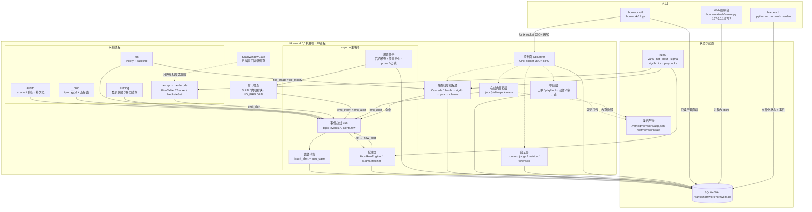
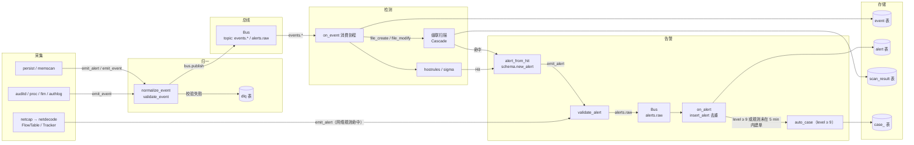
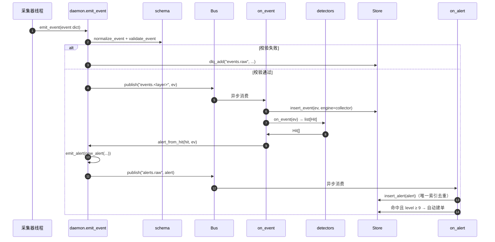
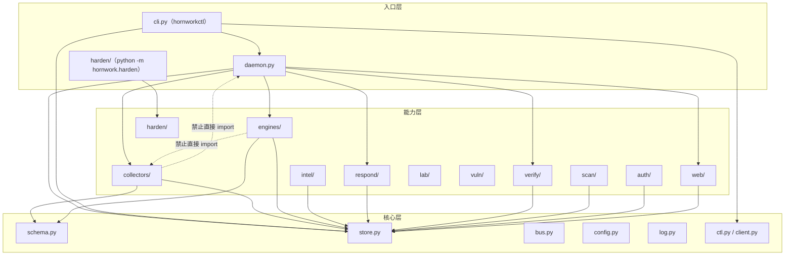

# Hornwork 架构设计

> 本文描述 Hornwork 当前实现的架构、进程/线程模型、事件流水线、控制面、数据模型、
> 存储与模块边界，并记录关键设计决策与取舍。所有路径、命令、表名、字段名均取自仓库
> 源码（`hornwork/`、`config.toml`、`Makefile`），不是纸面设计。
>
> 平台定位：**单进程、纯 Linux、纵深防御**。采集（主机/网络/内存）→ 统一事件模型 →
> 检测（签名、YARA、ClamAV、主机规则、Sigma、网络规则）→ 告警 → 工单/响应/审计链 →
> 验证与指标，全部用 Python 标准库 + `yara python` + `PyYAML` 实现，无消息中间件、
> 无前端框架、无分布式组件。

## 1. 总体架构



要点：

  采集器产出的**事件与告警**不直接落库；采集线程调用 daemon 注入的
  `emit_event` / `emit_alert` 回调，经总线交给主循环消费。采集器仍可直接写辅助状态
  （如 FIM 的 `baseline`、后门检查的 `meta` 标记），这些不属于事件流。
  总线是进程内的 `asyncio.Queue` 分发器（`hornwork/bus.py`），topic 约定为
  `events.<source_layer>` 与 `alerts.raw`；消费端由 `Bus.attach()` 起协程。
  控制面与 Web 是两条独立入口：CLI 通过 Unix socket 发一行 JSON RPC；Web 在同一
  进程内直接持有 `Store`（只读为主，少量写入），**不经过 socket**。
  规则与情报源文件（`rules/`）是检测逻辑的事实来源，运行期导入/热加载；运行时阈值与
  策略（如 `auth_policy` 表、`config.toml` 中的各类阈值）以库表/配置为准。

## 2. 进程与线程模型

整个平台是**一个 Linux 进程**（systemd 单元 `deploy/hornwork.service`，`Type=simple`，
以 `hornwork` 非 root 用户运行），进程内部是「一个 asyncio 主循环 + 多个工作线程」的混合模型。

| 执行体 | 归属 | 数量/生命周期 | 职责 | 关键配置 |
|---|---|---|---|---|
| asyncio 主循环 | `HornworkDaemon.run()` | 1，常驻 | 总线消费、周期任务、信号处理 | — |
| 采集线程 | `BaseCollector.start()` | auditd / proc / fim / authlog 各 1 | tail 文件、轮询 `/proc`、inotify、解析 auth 日志 | `collect.*.enabled` |
| 抓包线程 | `NetPipeline` | 2（抓包 + 处理） | `AF_PACKET` 抓包、解码、flow/tracker、网络规则判定 | `collect.net.*` |
| 静态扫描线程池 | `ThreadPoolExecutor` | `scan.workers`，默认 4 | 文件落地触发的级联扫描 | `[scan] workers` |
| 扫描窗口刷新线程 | `_start_scan_gate()` | 1 | 每 `scan.gates.window_refresh_sec`（默认 10 s）刷新活跃扫描窗口 | `scan.gates.*` |
| 周期任务协程 | `_periodic_loop()` | 1 个协程 | 每 `host.check_interval_sec` 跑后门检查；每小时情报老化；每 24 h `prune`；每 10 s 写心跳 | `[host] check_interval_sec` |
| 后台初始化线程 | `loop.run_in_executor` | 1 次 | 首次启动构建持久化基线，避免拖慢启动 | — |
| 控制面线程 | `CtlServer` | 1 accept 线程 + 每连接 1 线程 | Unix socket 上的一行 JSON RPC | `[ctl] socket/mode/group` |
| Web 线程 | `WebServer` | 1 个 `ThreadingHTTPServer` 线程（连接线程由标准库派生） | HTTP 控制台与 `/metrics` | `[web] bind/port/token` |

停止顺序（`HornworkDaemon._shutdown()`）：

```text
采集器 stop()（每个最多 join 3 s）
  → 抓包流水线 stop()
  → 周期协程 cancel()
  → 总线 drain(5.0) 再 stop()
  → 控制面 stop()
  → Web stop()
  → 扫描线程池 shutdown(cancel_futures=True)
  → 存储 close()
```

信号：`SIGTERM` / `SIGINT` 由 `loop.add_signal_handler` 捕获，置位 `asyncio.Event`，
主协程退出后统一走上面的关闭流程。

> **为什么不是多进程**：平台面向单机（上限是"一台 Linux 主机"），采集、检测、存储
> 共享同一份内存状态和同一个 SQLite；拆进程只会把"函数调用"变成"序列化 + IPC"，
> 并让采样窗口、去重、工单联动更难保持一致。代价见 §10。

## 3. 事件流水线

### 3.1 端到端数据流



一次事件的完整生命周期：



关键实现细节：

  **归一化**：`schema.normalize_event()` 补齐 `schema_version / event_id / ts / source_layer /
  source_product / host`，再由 `validate_event()` 校验；失败计数 `bad_events` 并写 `dlq` 表。
  **总线投递**：`emit_event()` 只做 `bus.publish("events." + source_layer, ev)`；主循环尚未
  绑定时先缓存（上限 10000 条），绑定后补投（`Bus.bind_loop`）。
  **消费顺序**：`events.*` 的消费协程（名 `store detect`）先 `insert_event`，再逐个调用
  `self.detectors`（`HostRuleEngine`、`SigmaMatcher`），命中转告警；单个检测器异常只计数
  `detector_errors`，不影响后续事件。
  **文件触发扫描**：`file_create` / `file_modify` 事件会走 `maybe_scan(path)`，按
  `scan.watch_on_file_event`、`engines.max_size_mb`、`scan.skip_dirs`、`scan.whitelist_paths`
  过滤后投进扫描线程池；扫描结果除写 `scan_result` 外，命中时生成 `SCAN <first_hit>` 规则告警。
  **告警落库**：`on_alert` 只调用 `store.insert_alert`；`alert` 表唯一索引
  `uq_alert_dedup(dedup_key, substr(ts,1,16))` 负责"同规则、同实体、同一分钟内"只保留一条。
  **告警联动**：`level ≥ 9` 时自动建单；同一 `dedup_key` 已有工单或同规则名在 5 分钟内
  建过单则复用，避免批量规则刷爆工单队列。

### 3.2 三条旁路流水线

| 流水线 | 入口 | 处理链 | 落库/产物 |
|---|---|---|---|
| 网络检测 | `NetPipeline` 抓包线程 | `decode()` → `FlowTable.update` → `Tracker` 行为窗口 → `NetRuleSet.evaluate()` | `emit_alert` → `alert` 表；`net_flow` / `net_connect` 事件 → `event` 表 |
| 静态扫描 | FIM 文件事件 / `hornworkctl scan file` / `ctl scan.file` | `Cascade.scan()`：hash 缓存 → sigdb → yara → clamav（`deep` 才启用 slow 引擎） | `scan_result` / `hash_cache` 表；`engine_stat` 统计 |
| 在线内存 | `ctl mem.scan` / 验证套件 TC 09 | `parse_maps` → 可疑段 `pread` → 条件 A（匿名 RWX/memfd）+ 条件 B（10 s 内新连接或线程 +5） | `mem_hits` / `mem_scan` 表；快照写 `raw/mem/` |

网络侧还有一条"扫描窗口降级"旁路：扫描子系统在运行前后写 `scan_window` 事件，
daemon 的 `ScanWindowGate` 每 10 s 刷新活跃窗口；`NetRuleSet` 求值时，仅当规则属于
`scan.window_suppress_rules` 且源/目标命中窗口，才跳过命中并计 `scan_window_suppressed`。
**只降级扫描类规则，不关闭规则**，IOC、畸形报文、外传类规则永不降级。

### 3.3 背压与失败隔离

`hornwork/bus.py` 的背压策略：

  每个订阅者队列上限 `bus.event_queue_max`（默认 100000）；队列满时**丢弃当前消息并
  累加 `dropped`**，不阻塞生产侧；`dropped` 每满 1000 条打一次 WARN。
  handler 抛异常计 `errors`，并调用已注册的 DLQ 回调（daemon 注册为 `store.dlq_add`）。
  单条消息失败、单文件扫描失败、单个采集器异常都不能中断主循环或采集循环：各层统一
  `try/except` + `log.warn`，计数进 `status().counters`。

## 4. 控制面（Unix socket JSON RPC）

```text
客户端 → 一行 JSON：{"id": 1, "method": "alerts.query", "params": {...}}
服务端 → 一行 JSON：{"id": 1, "ok": true, "result": {...}}
                     {"id": 1, "ok": false, "error": {"code","message","retryable","detail"}}
```

  实现：`hornwork/ctl.py` 的 `CtlServer`；监听 `[ctl].socket`（默认 `/run/hornwork/ctl.sock`），
  `chmod 0660`、属组 `adm`（都可配），backlog 16；**每个连接一个线程**，连接超时 600 s。
  仅 POSIX：`os.name != "posix"` 时 `start()` 直接告警跳过（Windows 开发机上 CLI 走只读回退）。
  客户端：`hornwork/client.py` 的 `CtlClient.call()`，超时由 `  timeout` 控制（默认 600 s），
  错误统一抛 `CtlError`。
  方法表（`HornworkDaemon._build_handlers()`，共 24 个）：

| 分组 | method | 说明 |
|---|---|---|
| 状态 | `status` | 版本、pid、主机、采集器、引擎、总线、Sigma、计数、ctl、web |
| 查询 | `events.query` | `{type,since,limit,layer}` → `{events:[...]}` |
| 查询 | `alerts.query` | `{since,level,technique,rule_ids,limit}` → `{alerts:[...]}` |
| 扫描 | `scan.file` | `{path,deep}` → 级联扫描结果 |
| 内存 | `mem.scan` / `mem.verify` | `{pid,snapshot}` / `{snapshot}` |
| 规则 | `rules.reload` | 重载 sigdb / yara / hostrules / sigma / netrules |
| 规则 | `sigma.stats` | Sigma 加载/支持/命中统计 |
| 情报 | `intel.import` / `intel.build` / `intel.list` | `{path}` / `{bundle}` / `{type,limit}` |
| 工单 | `case.create` / `case.list` / `case.update` | `{alert_id}` / `{status,limit}` / `{case_id,status,verdict}` |
| 响应 | `respond.run` | `{case_id,playbook,mode}` |
| 验证 | `verify.run` | `{suite,execute}` → 验证报告 dict（含 metrics） |
| 审计 | `audit.verify` | `{ok,rows,broken_seq}` |
| 取证 | `forensics.collect` / `forensics.analyze` / `forensics.compare` | AVML → Vol3 → 互证 |
| 统计 | `engine.stats` | `{days}` → 引擎统计 + 贡献度 |
| 运维 | `export` / `prune` | 导出、清理历史数据 |
| 联动 | `scan.window_refresh` | 扫描器发 `scan_window` 事件后立即刷新窗口缓存 |

CLI 的降级路径（`hornwork/cli.py`）：

  只读命令（`status` / `events` / `alerts` / `audit verify` / `export` / `prune`）在 daemon
  未运行、socket 不存在时直接打开 SQLite 查询；
  `scan file` 不在线时用同一套引擎离线扫描；
  `respond` / `forensics` 明确要求 daemon 在线，否则返回退出码 2；
  `verify run` 另有一条本地执行路径（见 `docs/verification.md`）。

> 注意：`scan`（定期漏洞扫描）、`asset`、`lab`、`vuln`、`auth` 等子系统的 CLI 命令**不经过
> 控制面**，它们在 CLI 进程内直接读写同一个 `hornwork.db`；控制面只覆盖 daemon 持有的
> 常驻能力（查询、扫描单个文件、内存、规则、情报、工单、响应、验证、取证、运维）。

## 5. Web 控制台

  实现：标准库 `http.server.ThreadingHTTPServer` + `BaseHTTPRequestHandler`，
  `hornwork/web/server.py`；线程名 `hornwork web`，停止时 3 s 内 join。
  绑定与鉴权（`WebServer.start()`）：
    只绑定 `[web].bind`（默认 `127.0.0.1`）；**未配置 token 且 bind 非回环时拒绝启动**；
    token 取 `[web].token` 或环境变量 `[web].token_env`（默认 `HORNWORK_TOKEN`，由
    `scripts/setup.sh` 写入 `/etc/hornwork/env`）；
    有 token 时，`/api/*` 与 `/metrics` 要求 `Authorization: Bearer <token>`；
    另外支持登录态：`/api/auth/login`、`/api/auth/step up`、`/api/auth/logout` 与
    session token（认证子系统的 LOA 会话），运维脚本仍可用静态 Bearer token；
    `/healthz` 与静态页面不需要 token。
  数据来源：Web 与 daemon 共享进程内的 `Store`，页面读取直接查库，不绕控制面。
  主要路由：

| 类型 | 路由 |
|---|---|
| 健康与指标 | `GET /healthz`、`GET /metrics`（Prometheus 文本） |
| 安全运营 | `GET /api/overview`、`/api/events`、`/api/alerts`、`/api/rules`、`/api/intel`、`/api/cases`、`/api/validate`、`/api/engine stats`、`/api/export` |
| 平台与子系统 | `GET /api/platform/security`、`/api/integration/status`、`/api/lab/envs`、`/api/vuln/records`、`/api/harden/status` |
| 扫描子系统 | `GET /api/scan/{overview,plans,tasks,findings,snapshots,diff,coverage,cve,reports}` |
| 认证子系统 | `GET /api/auth/{users,sessions,audit,policy}` |
| 写入 | `POST /api/cases`（建单）、`POST /api/intel`（导入 IOC）、`POST /api/rules`（记录热加载请求） |
| 静态页 | `GET /` 与 `GET /platform`（`web/static/platform.html`）、`GET /index.html`（`web/static/index.html`） |

> `POST /api/rules` 目前只在 Web 进程内记录"重载请求"标记，**不会**自动触发 daemon 重载；
> 真实热加载请用 `hornworkctl rules reload`（它在 CLI 进程内直接调用各引擎的 `reload()`）。

## 6. 数据模型

### 6.1 CanonicalEvent（schema v1.0）

所有采集器产出的统一事件，定义在 `hornwork/schema.py`。

必填：`schema_version`（固定 `1.0`）、`event_id`（UUIDv4）、`ts`（UTC ISO8601，毫秒 + `Z`）、
`source_layer`、`source_product`、`event_type`、`host.host_id`。

| 字段 | 类型 | 说明 |
|---|---|---|
| `event_id` | string | UUIDv4，事件主键（`event` 表 PK，`INSERT OR IGNORE` 幂等） |
| `ts` | string | UTC ISO8601，如 `2026 10 26T12:00:00.123Z` |
| `source_layer` | enum | `host / net / memory / static / scan` |
| `source_product` | string | 采集器名，如 `hornwork auditd`、`hornwork fim` |
| `event_type` | enum | 见下表 |
| `host` | object | `host_id / hostname / os`（来自 `[general]`，缺省取 `socket.gethostname()`） |
| `process` | object | `pid / ppid / image / cmdline / sha256 / uid / parent_image` |
| `file` | object | `path / sha256 / size / action / mode_exec` |
| `network` | object | `src_ip / src_port / dst_ip / dst_port / proto / domain / direction` |
| `user` | object | `name / uid / gid / src_ip / action` |
| `rule` | object | `id / name / engine / version / level / mitre[]` |
| `raw` | object | 采集器私有字段（`collector / audit_id / snapshot_seq` 等） |

`event_type` 全集（`schema.EVENT_TYPES`，20 个）：

```text
process_create  process_exit  file_create  file_modify  file_delete
net_connect     dns_query     logon        logon_fail   account_create
persist_item    memory_scan   scan_result  alert        net_flow
lab_action      vuln_finding
scan_task       scan_finding  scan_window
```

约束：

  JSON 不允许 `NaN` / `Infinity`（统一走 `schema.dumps()`）；
  单条消息上限 1 MB（`MAX_PAYLOAD_BYTES`），告警超限时把 `evidence` 替换为
  `{"note": "evidence truncated", "orig_bytes": ...}`；
  `dedup_key = sha256(rule_id|host_id|src_ip|dst_ip|dst_port|scheme|pid|extra)[:32]`。

### 6.2 DetectionAlert（schema v1.0）

由 `schema.new_alert(rule, ...)` 构造，可由事件/实体/时间触发。

| 字段 | 说明 |
|---|---|
| `alert_id` | UUIDv4，告警主键 |
| `ts` | 继承事件时间或显式传入 |
| `rule` | `{id, name, engine, version, level, mitre[]}` |
| `level` | 1–15；`severity_label()` 映射：≥12 critical、≥9 high、≥6 medium、≥3 low、其余 info |
| `confidence` | 0–100（级联扫描用命中分） |
| `technique` | `mitre[0]`，便于按 ATT&CK 检索 |
| `mitre` | `{tactics:[], techniques:[]}` |
| `entity` | `{host_id, src_ip, dst_ip, dst_port, proto}` |
| `dedup_key` | 去重键（见上） |
| `evidence` | 证据列表（命中偏移、路径、窗口计数等） |
| `intel` / `contrib` | 情报上下文 / 引擎贡献（`first_hit`、`also`、`cost_ms`） |
| `status` | 默认 `open` |
| `event_type` / `event_id` / `source_layer` | 回指来源事件 |
| `host/process/file/network/user/raw` | 从事件继承 |

### 6.3 Hit（规则命中）

扫描引擎与事件引擎统一返回 `list[dict]`，由 `hornwork.engines.base.make_hit()` 构造：
`{engine, rule_id, name, score(0–100), meta{}, evidence{}}`。
`hit_to_alert_fields()` 把 Hit 映射成 `new_alert()` 需要的 `rule/evidence/confidence`：
优先用规则自带 `level`，其次 `meta.severity`，否则 `score/10` 折算，避免把 0–100 的
score 当 1–15 的 level 用。

## 7. 存储（SQLite WAL）

`hornwork/store.py` 的 `Store`：

  单连接 + `threading.RLock`，`check_same_thread=False`，允许采集线程、网络线程、
  Web 线程、控制面线程并发调用；
  PRAGMA：`journal_mode=WAL`、`synchronous=NORMAL`、`foreign_keys=ON`、
  `busy_timeout=15000`；
  所有写操作内部 `commit`，异常向上抛，由调用方决定降级；
  复杂查询返回 `dict` 列表，`payload` 字段自动 JSON 解码；
  数据库文件：`[general].data_dir` 下的 `hornwork.db`（默认 `/var/lib/hornwork/hornwork.db`），
  同目录带 ` wal` / ` shm` 文件。

核心表（`store.DDL`，15 张）：

| 表 | 主键/唯一约束 | 用途 |
|---|---|---|
| `event` | PK `event_id`；索引 `ts`、`(event_type, ts)`、`(host_id, ts)` | 统一事件 |
| `alert` | PK `alert_id`；UNIQUE `(dedup_key, substr(ts,1,16))` | 检测告警 |
| `scan_result` | 自增 `id`；索引 `sha256`、`ts` | 单文件级联扫描结果 |
| `hash_cache` | PK `sha256` | 扫描结论缓存 |
| `ioc` | PK `ioc_id`；索引 `(type, value)` | 情报库（IP/域名/URL/哈希/文件名） |
| `baseline` | PK `path` | FIM 文件基线（sha256/mode/uid/size/mtime） |
| `case_` | PK `case_id` | 工单（`open→investigating→contained→closed`） |
| `action_audit` | PK 自增 `seq` | 处置动作审计哈希链 |
| `validation` | PK `(run_id, case_id)` | 验证用例逐条结果 |
| `sigma_stat` | PK `rule_id` | Sigma 规则加载/支持/命中 |
| `engine_stat` | PK `(engine, day)` | 引擎文件数/命中/耗时/错误 |
| `dlq` | 自增 `id` | 死信（校验失败的事件、handler 异常） |
| `meta` | PK `k` | 运行时元数据（基线标记、心跳） |
| `mem_hits` | 自增 `id`；索引 `ts`、`pid` | 在线内存扫描命中段 |
| `mem_scan` | 自增 `id` | 内存扫描汇总（含快照目录与 verdict） |

同一数据库还承载两类子系统表（各自模块负责建表）：

  扫描子系统（`hornwork/scan/store.py`，11 张）：`asset`、`scan_plan`、`scan_task`、
  `scan_finding`、`cve_cache`、`cve_component_map`、`scan_oval_fix`、`scan_cve_exclude`、
  `scan_snapshot`、`scan_snapshot_item`、`scan_diff_stat`；
  认证子系统（`hornwork/auth/db.py`，7 张）：`auth_user`、`auth_credential`、`auth_session`、
  `bio_template`、`auth_audit`、`auth_policy`、`trusted_device`（`[auth].db_path` 为空时共用本库）。

保留与维护：周期任务每 24 h 调 `store.prune(30, 7)`（事件 30 天、扫描结果 7 天）；
`hornworkctl prune   days N` 手动触发；告警、工单、审计链不随 `prune` 删除。

## 8. 模块边界与依赖方向



依赖规则（由代码结构与契约共同保证）：

1. **核心层不依赖能力层**：`schema/store/bus/config/log/ctl/client` 之间只有单向依赖
   （如 `store` 用 `schema` 的时间与序列化函数），不 import 任何采集器/引擎/daemon。
2. **能力层不 import daemon**：采集器通过构造函数注入的 `emit` / `emit_alert` 回调把数据
   交出去；引擎只实现 `BaseScanEngine` / `BaseEventEngine` 协议；告警/事件都以普通
   `dict` 传递，避免交叉 import。
3. **入口负责装配**：只有 `daemon.py`（常驻）与 `cli.py`（一次性命令）把模块拼起来；
   `web/server.py` 接收 `(cfg, store)`，不依赖 daemon。
4. **平台安全**：所有 Linux 专属调用（`os.fork`、`socket.AF_PACKET`、`ctypes` inotify、
   `/proc`、`ctypes` 内存读取）只出现在函数体内，不在导入期执行，因此 Windows 开发机
   可以 `import` 并跑纯逻辑单测。
5. **子系统自治**：扫描、靶场、漏洞档案、认证、加固各自持有存储访问与 CLI 分支，
   只共享核心层的 `Store` / `schema` / `log`，不修改彼此的数据表。

## 9. 关键设计决策与取舍

### 9.1 为什么是单进程

  **共享状态天然一致**：事件、告警、工单、审计链都在同一个 SQLite 连接上，检测器看到的
  就是刚落库的事件；如果拆成"采集进程 + 检测进程 + 存储服务"，就要处理跨进程时序、
  重复投递与事务边界。
  **部署简单**：一个 systemd 单元、一个 venv、一个配置文件；不需要 broker、注册中心、
  容器编排。目标环境是单台 Linux 主机（虚拟机/物理机均可）。
  **代价**：进程是单点故障（`Restart=on failure` 兜底）；Python GIL 使 CPU 密集的
  YARA/正则/内存扫描必须放线程池或外部进程（本实现用线程池 + 子进程调用 clamd/nmap/avml）；
  不能横向扩展，容量上限由单机决定。

### 9.2 为什么不用 Web 框架

  控制台需求固定：单页只读表格 + 少量写操作；标准库 `ThreadingHTTPServer` 足够，
  也避免为"单机自托管工具"引入前端构建链与 npm 依赖。
  鉴权逻辑简单可控（静态 Bearer token + 认证子系统的 session），没有 Cookie/CSRF/
  模板注入面。
  **代价**：路由、参数解析、静态资源、错误处理都要手写（`_Handler` 内约千行）；
  复杂交互（分页、图表）不如框架省力；页面是原生 JS 单页，不追求组件化。

### 9.3 为什么需要审计哈希链

  处置动作（隔离文件、杀进程、封 IP、锁账号、主机隔离、取证打包）具有破坏性，事后必须
  能证明"谁在什么时候对什么做了什么、有没有被篡改"。
  `action_audit` 每行记录 `prev_hash` 与 `hash`，`hash = sha256(prev_hash + "|".join(AUDIT_FIELDS))`，
  字段固定为 `ts / action_id / case_id / actor / action / target / mode / result`；首行
  `prev_hash=""`。`verify_chain()` 重算全链并返回首个断链 `seq`，入口是
  `hornworkctl audit verify`。
  只追加、不更新：任何对历史行的修改都会让后续哈希不匹配；`prune` 也不删除该表。
  **代价**：链是"防误改/防篡改"而非密码学不可否认（没有外部签名时间戳）；库损坏时可
  定位到具体行但无法自动修复；每次动作多一次写库与一次全表校验（行数少，成本可接受）。

### 9.4 为什么强调"可解释证据链"

平台的每个判定都要能回答"为什么告警"，而不是只给一个分数：

  `Hit` 携带 `engine / rule_id / score / evidence`；告警保留 `rule.version`、`mitre`、
  `confidence`、`evidence[]`、`contrib`，可回溯到规则与事件；
  级联扫描记录 `engines_used / first_hit / cost_ms`，`engine_stat` 与 `engine_contribution`
  给出各引擎命中和耗时；扫描子系统进一步提供 finding 的 `evidence`、快照四态 diff、
  加权覆盖率和 HTML 报告；
  验证层把每个用例的 `alerts[]` 摘要、`t0/t1`、`script/returncode/error` 写进 JSON+Markdown
  报告与 `validation` 表，指标可复算；
  工单、动作、审计链把"检测 → 研判 → 处置"串成同一条时间线。
  **代价**：证据体积大，需要 1 MB 截断、报告只保留告警摘要（`judge._ALERT_LIMIT=50`）、
  内存快照只保留前若干命中；存储增长快，依赖 `prune` 与快照清理策略。

### 9.5 为什么复用 nmap 而不自研端口识别

  服务版本识别（` sV`）依赖海量探针指纹与版本库，nmap 的 NSE/服务探针/CPE 输出是长期
  积累的结果；自研 connect + banner 只能识别少数明文协议，误报和漏报都会很高。
  项目把"自研"收敛到**编排与解释**：资产台账/计划/槽位/闸门/续跑、XML 归一、CVE 版本
  区间匹配与置信度、快照四态 diff、加权覆盖率、自包含 HTML 报告、扫描窗口自扰治理
  （`hornwork/scan/engines/nmap_adapter.py` 只做"拼命令 + 解析 XML + 转 RawResult"）。
  合规边界清晰：nmap 以独立进程调用，不复制其源码（GPL 2.0 边界）；目标受
  `[scan].allow_cidrs` 硬约束，越界一律拒绝并写 `action_audit`。
  **代价**：多一个系统依赖（`nmap` 必须在 PATH），XML 解析要兼容不同版本输出；
  端口/服务识别能力上限受 nmap 版本限制；扫描耗时长（`[scan].engine_timeout_sec` 默认 900 s），
  因此需要计划、窗口与并发闸门。

### 9.6 其他取舍

| 决策 | 理由 | 代价 |
|---|---|---|
| 事件/告警用普通 `dict` + 校验函数，不用 ORM/数据类 | 序列化直接、跨模块零拷贝、单测易构造 | 字段错误要到运行期才暴露，靠 `validate_*` 兜底 |
| 总线队列满即丢弃并计数 | 检测平台不能被慢消费者拖死 | 极端流量下会丢事件，需看 `dropped` 指标 |
| 取证/扫描/ClamAV 走子进程 | 崩溃隔离、超时可控、避免 Python C 扩展风险 | 进程启动开销；依赖外部二进制 |
| 默认 `observe` 模式 | 演示/生产都先观察，避免误处置 | 真实响应需显式 `enforce` + 审批 |
| 规则/策略文件化 | 可热加载、可审计、可离线分发 | 文件与库可能不一致，需 reload 与校验 |

## 10. 已知边界

  单机容量上限：SQLite 单写者、单进程内存；高吞吐场景需换列式存储/消息队列。
  采集覆盖依赖内核能力：auditd 需规则加载、`AF_PACKET` 需 `CAP_NET_RAW`、inotify 有
  watch 上限（`collect.fim.max_watches`）、`/proc/pid/mem` 受 Yama 限制。
  Windows 只用于开发与单测：控制面 socket、抓包、inotify、内存扫描均不可用。
  Web 控制台是"单机自托管"定位，不做多用户 RBAC，只有静态 token 与认证子系统会话两种入口。
  验证套件的模拟脚本随目标环境提供，仓库只带契约（见 `docs/verification.md`）。

## 11. 相关文档

| 文档 | 内容 |
|---|---|
| `docs/CONTRACT.md` | 内部接口契约（函数签名、数据结构、集成方式） |
| `docs/interfaces.md` | 接口与数据模型的可读说明 |
| `docs/rules.md` | 规则库与热加载 |
| `docs/runbook.md` | 部署、运维、故障排查 |
| `docs/verification.md` | 验证方法论与指标 |
| `docs/development.md` | 开发者指南 |
