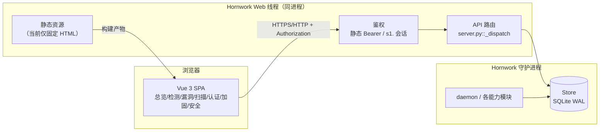
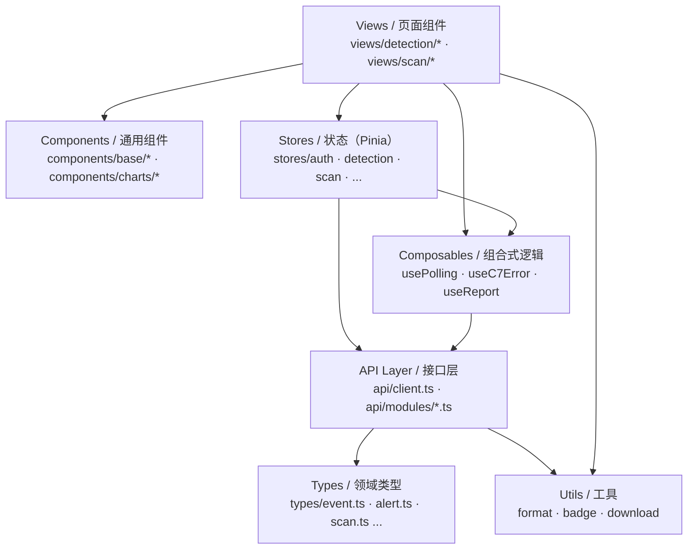
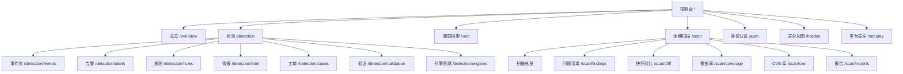
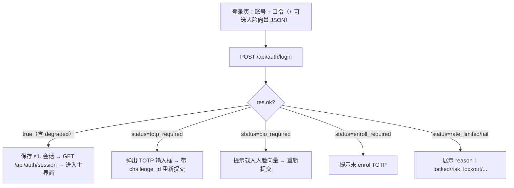
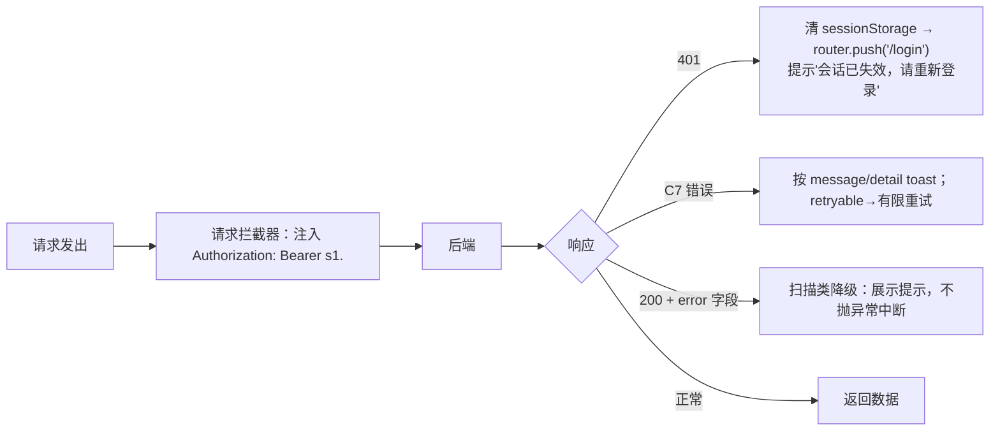

# Hornwork 前端架构设计文档（Vue 3 重构方案）

| 项目 | 内容 |
|---|---|
| 文档名称 | Hornwork 前端架构设计文档 |
| 文档版本 | v1.1（已落地） |
| 编写日期 | 2026-11-21 |
| 适用版本 | Hornwork 0.1.x |
| 文档状态 | 已实施（代码见 `frontend/`） |
| 关联文档 | `docs/architecture.md`、`docs/interfaces.md`、`docs/CONTRACT.md` |
| 代码依据 | `frontend/src/**`、`hornwork/web/server.py`、`hornwork/**` |

> 本文面向"用 Vue 技术栈重写 Hornwork 控制台、替换现有原生 JS 页面"这一具体目标。
> 所有 API 路径、字段名、枚举值、表结构均取自仓库源码，不是纸面设想。
> 行文约定：中文叙述，API 路径 / 字段 / 标识符保留英文原文。
>
> **v1.1 实施说明**：方案已落地为 `frontend/` 工程，并在 Ubuntu 24.04/26.04 虚拟机上
> 用真实后端 + 真实 Chrome 完成端到端验证。与初版草稿的差异集中在 §17（实施结果），
> 主要包括：采用方案 B（后端静态路由）而非单文件内联、UI 组件按 Element Plus 收敛
> （删除了与组件库重复的自研表格/抽屉）、`useAsync` 统一四态而非每页手写 loading。

---

## 目录

1. [背景与现状](#1-背景与现状)
2. [设计目标与原则](#2-设计目标与原则)
3. [技术选型](#3-技术选型)
4. [总体架构](#4-总体架构)
5. [后端 API 适配分析](#5-后端-api-适配分析)
6. [信息架构与路由设计](#6-信息架构与路由设计)
7. [状态管理设计](#7-状态管理设计)
8. [认证与安全设计](#8-认证与安全设计)
9. [通用能力与组件设计](#9-通用能力与组件设计)
10. [各功能域前端设计](#10-各功能域前端设计)
11. [数据可视化设计](#11-数据可视化设计)
12. [与后端的集成与改造建议](#12-与后端的集成与改造建议)
13. [构建、部署与迁移方案](#13-构建部署与迁移方案)
14. [非功能性设计](#14-非功能性设计)
15. [实施计划与风险](#15-实施计划与风险)
16. [附录](#附录)
17. [实施结果（v1.1）](#17-实施结果v11)

---

## 1. 背景与现状

### 1.1 平台定位

Hornwork（棱堡）是**单进程、纯 Linux 的纵深防御平台**：采集（主机 / 网络 / 内存 / 文件）→ 归一事件（`CanonicalEvent`）→ 检测（YARA / ClamAV / Sigma / 主机规则 / 网络规则）→ 告警 → 工单 / 响应 / 哈希链审计 → 验证与指标，并扩展出定期漏洞扫描、靶场编排、身份认证、安全加固四大子系统。

后端特征（来自 `docs/architecture.md`）：

- 单进程 `asyncio` 主循环 + 多工作线程；Web 与 daemon **同进程**，Web 直接持有 `Store` 查库，不经控制面 socket。
- Web 服务为标准库 `ThreadingHTTPServer`（`hornwork/web/server.py`，约 1466 行），默认绑定 `127.0.0.1:8787`。
- 存储为单个 SQLite（WAL），同一库承载核心表 + 扫描子系统 11 张表 + 认证子系统 7 张表。
- 安全模型：静态 Bearer token + 认证子系统会话（`s1.` 前缀）双入口；无 Cookie / CSRF；错误统一 C7 结构。

### 1.2 现有前端实现盘点

当前仓库存在**两套并存的原生 JS 单页**，均为单文件内联实现：

| 页面 | 文件 | 风格 | 鉴权方式 | 功能域 |
|---|---|---|---|---|
| 安全运营控制台 | `web/static/index.html` | 深色技术风（等宽字体、荧光绿） | 顶部输入框填静态 Bearer token（`localStorage`） | 8 个 tab：总览 / 事件流 / 告警 / 规则 / 情报 / 工单 / 验证 / 引擎贡献 |
| 纵深防御控制台 | `web/static/platform.html` | 蓝白企业风 | 三因子登录，会话存 `sessionStorage` | 7 个 tab：总览 / 检测 / 漏洞档案 / 定期扫描 / 身份认证 / 安全加固 / 平台安全 |

`server.py` 的路由映射：

- `GET /` 与 `GET /platform` → `platform.html`（简版控制台，主入口）
- `GET /index.html` → `index.html`（安全运营控制台）

### 1.3 现存问题

1. **两套页面功能割裂**：`index.html` 覆盖检测链细节（规则 / 情报 / 验证 / 引擎贡献），`platform.html` 覆盖五大子系统，用户需要在两个入口间切换，能力视角不统一。
2. **原生字符串拼装渲染**：`platform.html` 用 `panel()` / `table()` 拼 HTML 字符串并 `innerHTML` 注入，主观判断 `b-high`/`b-ok` 等徽章类；虽手写了 `esc()` 转义，但缺乏组件化、可维护性与类型约束，交互复杂后易出错。
3. **无路由、无状态管理**：`switchTab()` 纯内存切换，`state` 为全局对象；刷新即丢失筛选条件与当前页，`index.html` 的 token 用 `localStorage` 持久化、`platform.html` 用 `sessionStorage`，策略不一致。
4. **无分页 / 虚拟滚动**：所有列表靠 `limit` 截断（事件 100、告警 100、finding 2000 等），数据增长后无法翻页、首屏臃肿。
5. **无实时能力**：扫描任务、靶场运行等长时操作只能手动点"刷新"重新请求，无轮询 / 推送机制。
6. **可视化缺失**：事件趋势、引擎贡献、四态 diff、覆盖率矩阵等数据只以表格呈现，没有图表，研判效率低。
7. **无工程化构建链**：无 npm / 打包 / 类型检查 / 单元测试，产物即源码，难以做代码复用与质量保障。
8. **后端静态资源受限**：`server.py` 只服务固定 HTML，**没有通用静态资源路由**（详见 §5.5），任何带独立 JS/CSS 分块的前端都无法直接被托管——这是替换方案必须先解决的前置约束。

### 1.4 重构目标与非目标

**目标**

- G1：用一套 Vue 3 单页统一承载两套旧页面的全部功能域，并补齐交互（筛选、分页、详情抽屉、报告预览）。
- G2：引入 TypeScript，把后端字段与枚举固化为前端类型，形成可校验的前后端契约。
- G3：组件化 + 状态管理 + 统一请求层，消除字符串拼装，提升可维护性。
- G4：保持与现有后端 API **零侵入兼容**（能不改后端就不改）；必须改动处给出最小改造方案。
- G5：补齐可视化（趋势 / 分布 / 矩阵 / 状态时间线）与长时任务的轮询体验。
- G6：保持安全语义：双鉴权、C7 错误、401 拦截、XSS 防护、不落地敏感信息。

**非目标**

- N1：不改变后端业务能力与数据模型，不新增后端业务写入逻辑（除明确列出的配套增强）。
- N2：不做多租户、RBAC、分布式部署（后端定位是单机自托管，见 `docs/architecture.md` §10）。
- N3：不在首版实现所有"后端能力缺口"里的写操作（如扫描触发 / 靶场编排），这些依赖后端新增 API，列入后续阶段。
- N4：不引入 SSR / 微前端 / 复杂状态库，避免过度工程。

---

## 2. 设计目标与原则

| 原则 | 含义 | 落地方式 |
|---|---|---|
| 契约先行 | 以后端真实 API / 字段为唯一事实来源 | `src/types/` 按后端 schema 定义 TS 类型；API 层集中声明 |
| 零信任渲染 | 所有后端字符串视为不可信数据 | 默认插值转义；`v-html` 仅用于白名单化的报告预览（iframe/sandbox） |
| 分层清晰 | 视图不直接碰 fetch | View → Store/Composable → API Client → HTTP |
| 渐进增强 | 先 1:1 复刻，再补体验 | 阶段一功能对齐，阶段二可视化与轮询，阶段三写操作 |
| 后端最小改动 | 兼容优先，改造可控 | 提供"单文件构建"零改动方案与"静态路由"标准方案（§5.5） |
| 一致性体验 | 统一加载 / 空 / 错误 / 徽章 / 时间格式 | 全局组件 + 请求拦截器统一处理 |
| 可观测 | 前端异常可定位 | 全局错误捕获、请求日志、C7 detail 展示 |

---

## 3. 技术选型

### 3.1 选型清单

| 类别 | 选型 | 版本基线 | 理由 |
|---|---|---|---|
| 框架 | Vue 3（Composition API + `<script setup>`） | ≥3.4 | 组件化、响应式、`defineProps/defineEmits` 类型推导，替代字符串拼装 |
| 语言 | TypeScript | ≥5.4 | 后端字段多、枚举多，编译期校验前后端契约，减少字段拼写错误 |
| 构建 | Vite | ≥5 | 冷启动快、按需构建、产物可配置单文件；生态成熟 |
| 路由 | Vue Router 4 | ≥4.3 | 嵌套路由映射五大子系统；`createWebHashHistory` 可免去后端改造 |
| 状态 | Pinia | ≥2.1 | 轻量、TS 友好、按域分 store，替代全局 `state` 对象 |
| UI 组件 | Element Plus | ≥2.7 | 表格 / 表单 / 抽屉 / 标签页 / 描述列表齐全，中文文档完善，企业后台适配度高 |
| 图表 | ECharts | ≥5.5 | 事件趋势、引擎贡献、CVE 分布、覆盖率矩阵等；按需引入控制体积 |
| HTTP | Axios | ≥1.6 | 拦截器统一注入 token、处理 C7 错误与 401，优于裸 `fetch` |
| 工具集 | `@vueuse/core` | ≥10 | `useIntervalFn`（轮询）、`useStorage` 等，减少样板代码 |
| 包管理 | pnpm | ≥9 | 依赖复用、磁盘效率高 |
| 代码规范 | ESLint + Prettier + `vue-tsc` | — | 提交前类型检查与格式化 |
| 测试 | Vitest（含 jsdom） | ≥1.6 | 对 API 解析、格式化、状态逻辑做单测 |

> 备选：若团队更看重 TS 类型体验与轻量，可用 **Naive UI** 替代 Element Plus（同样 TS 友好、无全局样式污染）；本文以 Element Plus 为例展开。

### 3.2 关键取舍说明

- **为何 hash 路由优先**：后端当前无 SPA fallback（§5.5），`createWebHashHistory` 使所有页面 URL 形如 `/#/scan`，浏览器只请求根文档，不触发后端 404，可实现**零后端改动的平滑替换**。若采用 `createWebHistory`，则必须同步实施 §5.5 的后端静态路由改造。建议：阶段一用 hash，阶段二在后端改造完成后切 history。
- **为何不引 SSR / 微前端**：单机自托管控制台，SEO 无诉求，功能域强相关，SSR 与微前端只会增加部署复杂度。
- **为何保留 Element Plus 而非纯 Tailwind**：后台管理场景下表格 / 表单 / 抽屉等复杂组件自研成本高，成熟组件库能保证一致性与可访问性。

### 3.3 工程规范

```
Node.js  ≥ 20 LTS        │  包管理：pnpm
提交规范：Conventional Commits（feat/fix/docs/refactor…）
分支策略：main（可发布）/ develop（集成）/ feature/<域>
质量门禁：pnpm lint && pnpm typecheck && pnpm test（CI 必过）
```

---

## 4. 总体架构

### 4.1 前端在系统中的位置



要点：Vue 前端是**纯展示 + 轻交互层**，所有业务判断仍在后端；Web 与 daemon 同进程意味着 API 读取的是实时库状态，前端只需负责轮询节奏与呈现。

### 4.2 分层架构



**依赖方向**：View 只依赖 Store / Component / Composable；只有 API Layer 直接调用 Axios；类型定义独立于运行时。禁止在 View 中直接 `fetch`。

### 4.3 目录结构

```
frontend/
├── index.html                      # Vite 入口（构建后产出 dist/index.html）
├── vite.config.ts                  # 含 base、proxy（dev 指向 8787）、可选 singlefile 插件
├── tsconfig.json
├── package.json
├── src/
│   ├── main.ts                     # createApp / 挂载 Pinia、Router、ElementPlus
│   ├── App.vue                     # 根布局：侧边栏 + 顶栏 + <router-view>
│   ├── router/
│   │   └── index.ts                # 路由表 + 守卫（登录校验）
│   ├── types/                      # 与后端契约对应的 TS 类型（按域分文件）
│   │   ├── common.ts               # C7Error、Paginated<T>、枚举/徽章映射
│   │   ├── event.ts                # CanonicalEvent、Alert、Case
│   │   ├── scan.ts                 # Asset/Plan/Task/Finding/Snapshot/CVE
│   │   ├── vuln.ts                 # VulnRecord、LabEnv、LabRun
│   │   ├── auth.ts                 # LoginReq/Resp、Session、User、Policy、Audit
│   │   └── harden.ts               # BaselineItem、Plan、Run、Report、Security
│   ├── api/
│   │   ├── client.ts               # Axios 实例 + 拦截器（token / C7 / 401）
│   │   └── modules/
│   │       ├── auth.ts             # /api/auth/*
│   │       ├── overview.ts         # /api/overview, /api/integration/status
│   │       ├── detection.ts        # /api/events, /api/alerts, /api/rules, /api/intel,
│   │       │                       # /api/cases, /api/validate, /api/engine-stats, /api/export
│   │       ├── vuln.ts             # /api/vuln/records, /api/lab/envs
│   │       ├── scan.ts             # /api/scan/*, /api/scan/reports
│   │       └── platform.ts         # /api/harden/status, /api/platform/security
│   ├── stores/
│   │   ├── auth.ts                 # 会话、用户、LOA、登录/登出/step-up
│   │   ├── app.ts                  # 侧栏折叠、主题、全局请求态
│   │   └── domains/                # 各域筛选条件、缓存数据（可选按域拆）
│   ├── composables/
│   │   ├── usePolling.ts           # 长时任务轮询（扫描任务/靶场运行）
│   │   ├── useC7Error.ts           # 统一错误提示
│   │   ├── useReport.ts            # 报告打开（/api/report?file=）
│   │   └── useTableQuery.ts        # 表格筛选 → query 参数序列化
│   ├── components/
│   │   ├── base/                   # StatCard, PanelCard, SeverityBadge, StatusBadge,
│   │   │                           #  EmptyState, LoadingState, KVList, TimeText, DataTable
│   │   ├── charts/                 # TrendChart, EngineContributionChart,
│   │   │                           #  SeverityPie, CoverageMatrix, DiffBar
│   │   └── layout/                 # AppSidebar, AppHeader, LoginCard
│   ├── views/
│   │   ├── LoginView.vue
│   │   ├── OverviewView.vue
│   │   ├── detection/              # EventsView, AlertsView, RulesView, IntelView,
│   │   │                           #  CasesView, ValidationView, EnginesView
│   │   ├── VulnView.vue
│   │   ├── ScanView.vue
│   │   ├── AuthView.vue
│   │   ├── HardenView.vue
│   │   └── SecurityView.vue
│   ├── styles/
│   │   ├── tokens.css              # 设计变量（沿用旧版蓝白 / 可选深色主题）
│   │   └── index.css
│   └── utils/
│       ├── format.ts               # 时间/CVSS/字节/JSON 的可读化（对齐旧 ts/num/esc）
│       └── badge.ts                # 严重级/状态 → 徽章类型的集中映射
└── tests/
    ├── unit/                       # 工具函数、类型解析、store 逻辑
    └── e2e/                        # Playwright：登录 → 各域渲染 → 登出（可选）
```

---

## 5. 后端 API 适配分析

### 5.1 API 全景总表

后端 `server.py` 的有效路由（已按功能域归类）。**除标注"免鉴权"外，全部需要 Bearer token**。

| 域 | 路由 | 方法 | 关键 query / body | 响应形状 |
|---|---|---|---|---|
| 系统 | `/healthz` | GET | —（免鉴权） | `{ok,service,version,ts,auth,web}` |
| 系统 | `/metrics` | GET | — | Prometheus 文本 |
| 认证 | `/api/auth/login` | POST | `{username,password,ip?,embedding?,totp?,device_token?}`（免鉴权） | `{status,ok,token?,session?,loa?,loa_name?,factors?,risk?,degraded?,reason?,ts}` |
| 认证 | `/api/auth/step-up` | POST | `{token?,totp,embedding?}`（免鉴权） | `{status,ok,loa?,loa_name?,similarity?,reason?,ts}` |
| 认证 | `/api/auth/logout` | POST | `{token?}`（免鉴权） | `{status,ok,ts}` |
| 认证 | `/api/auth/session` | GET | —（`s1.` 会话） | `{ok,ts,session,user,loa,loa_name}` |
| 认证 | `/api/auth/users` | GET | — | `{items[],count,ts}` |
| 认证 | `/api/auth/sessions` | GET | — | `{items[],ts}` |
| 认证 | `/api/auth/audit` | GET | `?limit=30`(1–200) | `{items[],chain{ok,checked,...},ts}` |
| 认证 | `/api/auth/policy` | GET | — | `{policy{8 组},ts}` |
| 总览 | `/api/overview` | GET | `?days=7` | `{ts,counts,engine_stats,sigma,recent_scans,validation,web}` |
| 总览 | `/api/integration/status` | GET | — | `{ts,host,modules{detection,vuln,scan,auth,harden}}` |
| 检测 | `/api/events` | GET | `type\|event_type,since,layer\|source_layer,limit≤1000` | `{ts,count,items}` |
| 检测 | `/api/events/recent` | GET | `?limit≤200` | `{items[],count,ts}` |
| 检测 | `/api/events/types` | GET | — | `{items[{type,n}],ts}` |
| 检测 | `/api/alerts` | GET | `since,level_min,technique,rule_id,limit≤1000` | `{ts,count,items}` |
| 检测 | `/api/rules` | GET / POST | POST `{action:"reload",note?}` | GET `{items,sources,missing,sigma,reload}` / POST 201 `{ok,action,...}` |
| 检测 | `/api/intel` | GET / POST | GET `kind,status,limit≤5000`；POST `{records[]\|path}` | GET `{items,count,by_type}` / POST 201 `{imported,skipped,total}` |
| 检测 | `/api/cases` | GET / POST | GET `status,limit`；POST `{title,severity,verdict?,dedup_key?}` | `{items,count}` / 201 `{ok,case_id,case,...}` |
| 检测 | `/api/validate` | GET | `run_id?,limit≤2000` | `{run_id,rows[],case_count,metrics,report_path,md_path}` |
| 检测 | `/api/engine-stats` | GET | `days≤90,limit≤200` | `{engine_stats,contribution,sigma,recent_scans}` |
| 检测 | `/api/export` | GET | `format=jsonl\|md,kind=alerts\|events\|validation,since,limit,run_id` | 文件下载（带 `Content-Disposition`） |
| 扫描 | `/api/scan/overview` | GET | — | `{counts,assets,plans,tasks,snapshots,findings,cve,recent_tasks,last_task,last_snapshot}` |
| 扫描 | `/api/scan/plans` | GET | — | `{items[{plan_id,name,kind,profile,selector,engines,window_*,enabled,last_run,next_run}],total}` |
| 扫描 | `/api/scan/tasks` | GET | `limit≤1000,status,run,plan` | `{items[{task_id,run_id,plan_id,asset_id,status,stage,progress,checkpoint,snapshot_id,cost_ms,...}],total}` |
| 扫描 | `/api/scan/findings` | GET | `asset,severity,status,kind,limit≤2000` | `{items[{finding_id,kind,check_id,severity,cvss,confidence,status,evidence,...}],total}` |
| 扫描 | `/api/scan/snapshots` | GET | `limit≤200` | `{items[{snapshot_id,kind,label,is_base,task_count,finding_count,stats}],total}` |
| 扫描 | `/api/scan/diff` | GET | `from=<新>,to=<旧>`（缺省最近两次） | `{cur,prev,items[],stats{new,fixed,persisting,regressed},by_severity,error?}` |
| 扫描 | `/api/scan/coverage` | GET | `snapshot?` | `{coverage,by_domain{D1..D6},matrix[],uncovered[],weights}` |
| 扫描 | `/api/scan/cve` | GET | — | `{total,by_severity,by_source,by_year,last_modified,oval_fixes,component_map}` |
| 扫描 | `/api/scan/reports` | GET | — | `{items[{name,rel:"scan/x.html",size,mtime}]}` |
| 漏洞 | `/api/vuln/records` | GET | `limit≤1000,cwe,severity` | `{records[{id,cve,title,component,cwe,cvss_score,severity,status,...}]}` |
| 靶场 | `/api/lab/envs` | GET | `limit≤100`（仅作用于 runs） | `{envs[{env_id,state,running,ports,expires_at,...}],runs[],ts}` |
| 加固 | `/api/harden/status` | GET | — | `{items[],plans[],runs[],reports[],ts}` |
| 平台 | `/api/platform/security` | GET | — | `{ts,https,lockout,paths,service,bind}` |
| 报告 | `/api/report` | GET | `file=<rel>` | 文件内容（HTML→`text/html`，其余 `text/plain`；路径穿越校验） |

> **扫描 8 个 GET 路由是按需挂载**（`server.py` 用 `getattr(self, _attr, None)` 探测 handler 是否存在），handler 缺失时退化为 404；且经 `_scan_api()` 惰性 `init_schema`。前端应容忍这些路由偶发 404/空结构。

### 5.2 响应与错误的统一约定

1. **列表形状三分天下**：多数接口为 `{items,total,ts}`；`count` 常与 `items.length` 相等（非真实总数，因为无 offset 分页）；例外：`/api/vuln/records` 用 `records`、`/api/lab/envs` 用 `envs`+`runs`。API 层需做**形状归一化**。
2. **C7 统一错误**：`{code:int(HTTP 状态), message:str, retryable:bool, detail:str|null}`，`detail` 截断 800 字。前端按 `retryable` 决定是否自动重试；`code` 即 HTTP 状态码。
3. **容错优先**：扫描 / 靶场 / 加固 / 平台类 handler 捕获一切异常后返回 **200 + 空结构 + `error` 字段**，而非 500。前端必须把 `error` 当一等公民处理（展示降级提示，而不是当作正常空数据）。
4. **方法严格**：PUT / DELETE 一律 405；GET-only 路径用 POST 或反之均 405；未知路由 404。
5. **时间**：全部 UTC ISO8601（毫秒+`Z`）；扫描报告的 `mtime` 是本地时间字符串，需分别格式化。

### 5.3 写操作能力矩阵（重要约束）

后端 Web 层**几乎只读**，写能力极有限。这决定了首版前端的定位边界：

| 能力 | Web API 现状 | 前端策略 |
|---|---|---|
| 建工单 | `POST /api/cases` ✅ | 可做"新建工单"抽屉 |
| 导入 IOC | `POST /api/intel` ✅（records 或**服务端** path） | 可做"贴入 records JSON"；本地文件上传需后端配合 |
| 规则热加载标记 | `POST /api/rules` ✅（仅记内存标记，非即时生效） | 可做"请求重载"按钮 + 状态提示 |
| 登录 / step-up / 登出 | `POST /api/auth/*` ✅ | 完整实现（含 step-up） |
| 处置动作 / 审批 | ❌ 仅 CLI/ctl（`respond.run`） | 首版只读展示，不做触发 |
| 扫描计划配置 / 任务触发 | ❌ 仅 CLI/daemon | 首版只读展示 |
| 靶场 up/down/isolate | ❌ 仅 CLI/LabCtl | 首版只读展示 |
| finding 确认 / 转工单 | ❌ 仅 CLI | 首版只读展示 |
| 报告生成 / 导出 | 导出 ✅ `GET /api/export`；报告生成 ❌ | 导出可做，生成不做 |

> 结论：首版是"**统一只读看板 + 少量已有写操作**"。真正的运维操作仍需 `hornworkctl`，UI 中应以文案说明引导，不应伪造可点击但无效的操作。

### 5.4 请求层关键适配点

| 适配点 | 说明 | 落地位置 |
|---|---|---|
| token 双轨 | 平台会话 `s1.` 用 `Authorization: Bearer <session>` 或 `X-Hornwork-Session`；运维静态 token 仅脚本用 | `api/client.ts` 请求拦截器 |
| 401 拦截 | 清会话 → 跳登录，排除 `/api/auth/login` | axios 响应拦截器 |
| C7 解析 | `message`/`detail` 转 toast；`retryable` 驱动重试 | 响应拦截器 + `useC7Error` |
| 200+error 降级 | 扫描/靶场类接口成功态也可能带 `error` | API 模块统一检测并抛"软错误" |
| 形状归一化 | `records`/`envs`/`runs`/`items` → 统一 `Paginated<T>` | 各 `api/modules/*.ts` 的解析函数 |
| 文件下载 | `/api/export` 需带 header → `fetch` + `blob` + `URL.createObjectURL`，不能用 `window.location` | `utils/download.ts` |
| 报告预览 | `/api/report?file=<rel>` 返回 HTML → iframe `sandbox` 或新标签 | `useReport` |
| 2MB 限制 | `POST /api/intel` 大 records 需分批或提示 | IntelView 输入校验 |

### 5.5 静态资源托管约束与方案（前置关键问题）

**问题**：`server.py` 只实现了固定路由：

```python
GET /            → static/index.html 的替代（platform.html）
GET /index.html  → static/index.html
GET /platform    → static/platform.html
GET /favicon.ico → 204
```

它**没有通用静态文件路由**，也不会服务 Vite 产物里的 `assets/index-xxxx.js` / `assets/index-xxxx.css`。这是替换方案必须先解决的前置约束。给出三种方案：

| 方案 | 做法 | 后端改动 | 优点 | 缺点 | 建议 |
|---|---|---|---|---|---|
| **A. 单文件内联构建** | 用 `vite-plugin-singlefile` 把 JS/CSS 全部内联进 `index.html`，覆盖 `static/platform.html` | **零改动** | 最快落地、完全兼容现状 | 首包较大（ElementPlus+ECharts 可能 1–2MB）；无分块缓存 | ✅ 阶段一推荐 |
| **B. 通用静态路由 + history** | 后端新增 `GET /assets/*` 服务 `dist/assets`，根路径返回 `dist/index.html`，支持 SPA fallback | 小（约 30 行） | 标准工程化、可分块缓存 | 需改后端并回归测试 | ✅ 阶段二推荐 |
| **C. 反向代理托管** | nginx 托管 `dist/`，`/api/*` 反代到 8787 | 零 | 性能 best、静态与 API 分离 | 增加部署组件，偏离"单进程自托管"定位 | 可选（已有 nginx 8443 反代可复用） |

> 无论哪种方案，建议**前端统一用 hash 路由**（`#/scan`）：方案 A 下完全无需后端配合；方案 B 下即便没有 SPA fallback 也不会 404。若阶段二确认采用 history 路由，则必须同时实施方案 B 的 fallback。

---

## 6. 信息架构与路由设计

### 6.1 合并两套旧页面的信息架构

新控制台把 `index.html`（检测细节）与 `platform.html`（五大子系统）整合为**统一的 7 个一级域**，把旧 `index.html` 的检测细节作为"检测域"下的二级抽屉/子页：



### 6.2 路由表（Vue Router）

```ts
// src/router/index.ts —— 采用 hash 历史，避免后端 SPA fallback 改造
createRouter({
  history: createWebHashHistory(),
  routes: [
    { path: '/login', name: 'login', component: LoginView, meta: { public: true } },
    {
      path: '/', component: AppLayout, redirect: '/overview',
      children: [
        { path: 'overview', name: 'overview', component: OverviewView },
        {
          path: 'detection', name: 'detection', redirect: '/detection/events',
          children: [
            { path: 'events', name: 'detection-events', component: detection/EventsView },
            { path: 'alerts', name: 'detection-alerts', component: detection/AlertsView },
            { path: 'rules',  name: 'detection-rules',  component: detection/RulesView },
            { path: 'intel',  name: 'detection-intel',  component: detection/IntelView },
            { path: 'cases',  name: 'detection-cases',  component: detection/CasesView },
            { path: 'validation', name: 'detection-validation', component: detection/ValidationView },
            { path: 'engines', name: 'detection-engines', component: detection/EnginesView },
          ],
        },
        { path: 'vuln', name: 'vuln', component: VulnView },
        {
          path: 'scan', name: 'scan', redirect: '/scan/overview',
          children: [
            { path: 'overview', name: 'scan-overview', component: scan/ScanOverviewView },
            { path: 'findings', name: 'scan-findings', component: scan/FindingsView },
            { path: 'diff',     name: 'scan-diff',     component: scan/DiffView },
            { path: 'coverage', name: 'scan-coverage', component: scan/CoverageView },
            { path: 'cve',      name: 'scan-cve',      component: scan/CveView },
            { path: 'reports',  name: 'scan-reports',  component: scan/ReportsView },
          ],
        },
        { path: 'auth', name: 'auth', component: AuthView },
        { path: 'harden', name: 'harden', component: HardenView },
        { path: 'security', name: 'security', component: SecurityView },
      ],
    },
  ],
});
```

**路由守卫**：`beforeEach` 检查 `authStore.session`；无会话且目标非 `public` → 重定向 `/login`。**注意与后端 401 拦截配合**：守卫只做前端体验拦截，真正鉴权在后端，拦截器负责运行时失效。

### 6.3 导航与 UI 结构

沿用 `platform.html` 的蓝白企业风侧边栏（可切换深色主题），一级域分组：

```
┌─────────────┬──────────────────────────────────────────────┐
│ Hornwork    │ 顶栏：页标题 | LOA | 主机 | 刷新 | 退出        │
│ 纵深防御控制台├──────────────────────────────────────────────┤
│             │                                              │
│ 总览        │  <router-view>                               │
│ ── 功能域 ── │  （统计卡片 + 面板 + 表格 + 图表 + 抽屉）      │
│ 检测        │                                              │
│ 漏洞档案    │                                              │
│ 定期扫描    │                                              │
│ 身份认证    │                                              │
│ 安全加固    │                                              │
│ 平台安全    │                                              │
│ ─────────   │                                              │
│ 已登录:xxx  │                                              │
└─────────────┴──────────────────────────────────────────────┘
```

---

## 7. 状态管理设计

### 7.1 Pinia Store 划分

| Store | 职责 | 关键 state | 关键 action |
|---|---|---|---|
| `auth` | 会话与身份 | `session`,`who`,`loa`,`factors`,`degraded` | `login()`,`stepUp()`,`logout()`,`fetchSession()`,`clear()` |
| `app` | 全局 UI 态 | `sidebarCollapsed`,`theme`,`globalLoading` | `toggleSidebar()`,`setTheme()` |
| `detection` | 检测域筛选 | `eventFilter`,`alertFilter`,`intelFilter`,`caseFilter`,`cache` | `setFilter()`,`loadEvents()`,`loadAlerts()`… |
| `scan` | 扫描域筛选/轮询 | `findingFilter`,`taskPolling`,`selectedSnapshot` | `loadFindings()`,`startTaskPolling()` |
| `overview` | 总览汇总数据 | `summary`,`integration` | `load()` |

> 域级 Store 只保存**筛选条件与轻量缓存**，表格数据由各 View 通过 Composable 自行请求并持有，避免大对象常驻内存。是否拆域 Store 可按团队偏好退化到"View 内 `ref` + Composable"。

### 7.2 认证 Store 设计要点

```ts
// src/stores/auth.ts（要点伪码）
export const useAuthStore = defineStore('auth', () => {
  const session = ref<string>(sessionStorage.getItem('hornwork_session') || '');
  const who = ref<SessionInfo | null>(null);

  async function login(payload: LoginReq) {
    // embedding 必须是纯 number[]（512 维），不能是 {vector:[...]}
    const res = await api.auth.login(payload);
    if (!res.ok) throw new C7Error(res);              // status=totp_required/bio_required 等
    session.value = res.token;
    sessionStorage.setItem('hornwork_session', res.token);
    who.value = await api.auth.session();             // 拉 /api/auth/session
    return res;
  }

  async function stepUp(payload: StepUpReq) { /* /api/auth/step-up */ }

  function clear() {
    session.value = '';
    who.value = null;
    sessionStorage.removeItem('hornwork_session');
  }

  return { session, who, loa: computed(() => who.value?.loa), login, stepUp, logout, clear };
});
```

**会话存储决策**：沿用 `platform.html` 的 `sessionStorage`（关标签页即失效，安全优于 `localStorage`）。不落地静态 token（那是脚本用途）。可选增强：按 `who.idle_expires_ts` 在前端做空闲倒计时提醒（后端靠下一次 401 兜底）。

### 7.3 Composable 设计

- `usePolling(fn, { interval, stopWhen })`：基于 `useIntervalFn`；用于扫描任务、靶场运行、总览看板。终态判定后自动停止，组件卸载时清理。
- `useTableQuery()`：把筛选 reactive 对象序列化为 query（处理 `level_min` vs `level`、`run`/`plan` 别名、`from`/`to` 反向语义）。
- `useC7Error()`：把 C7 错误 + 扫描类的 200+`error` 统一转成用户可读提示。
- `useReport()`：`openReport(rel)` —— `fetch /api/report?file=` + `blob` → 新标签 `URL.createObjectURL`，或 iframe `sandbox="allow-same-origin"`（报告为可信本地产物，但无 CSP，优先新标签）。

---

## 8. 认证与安全设计

### 8.1 登录流程（对齐后端状态机）

后端有两条登录路径，前端需完整支持：



要点：

- **判断登录成功以 `ok` 字段为准**，不要用 `status==='ok'`（后端存在 `degraded` 布尔字段与 status 混用的历史；`status='ok'` 且 `degraded=true` 仍算成功）。
- **人脸向量**：读取 `.json` 文件后 `JSON.parse`，规范化为**纯 `number[]`**（512 维）；若用户传了 `{"vector":[...]}` 对象需兼容取出数组，否则后端 `isinstance(list)` 判断不通过会静默忽略人脸因子。文件需 < 2MB（请求体上限）。
- **TOTP 状态机**：`totp_required` 响应带 `challenge_id`、`required_loa`、`expires_in`（120s）；前端保存 challenge 并展示二次输入。`platform.html` 未实现这条分支，Vue 版需补齐。
- **降级语义**：`degraded=true` + `degrade_reason`（bio_not_enrolled/bio_mismatch/loa_capped/risk_high）应在顶栏以告警色提示"当前为降级认证，LOA 受限"。

### 8.2 step-up 设计（新增能力）

后端已实现 `/api/auth/step-up`，但旧前端未用。设计：

- 触发时机：进入"身份认证"域的敏感展示、或未来任何敏感操作时，若 `who.loa < 3`，弹出 step-up 对话框收集 `totp` + 可选 `embedding`，调用 `/api/auth/step-up`。
- 强认证窗口 `strong_window_sec=900`：LOA 够但超 15min 也要求重认证。前端可按 `who.session.strong_auth_ts` 本地提示。
- 失败 reason：`stepup:*` 系列，按 C7 展示。

### 8.3 鉴权拦截与 401 处理



- 免鉴权路径白名单：`/api/auth/login|step-up|logout`（拦截器跳过 token 注入与 401 跳转）。
- `/metrics` 是 Prometheus 文本，不在 SPA 请求范围。
- 后端无 CSP / X-Frame-Options；安全 headers 仅 `no-store`/`nosniff`/`close`。前端不得依赖这些做内容安全。

### 8.4 XSS 与内容安全

- 默认 Vue 插值（转义）；**禁止**用 `v-html` 渲染后端字符串（事件 payload、IOC 值、工单标题等均不可信）。
- 报告预览：报告为本地生成的可信 HTML，但仍用新标签或 iframe `sandbox` 隔离；`/api/report` 的 `file` 参数必须是 `rel`（如 `scan/xxx.html`），路径穿越已被后端拦截。
- 导出下载用 `blob`，不把 token 暴露到 URL。
- 不在前端存储口令、人脸原始向量（仅内存短暂持有后提交，提交后立即清理 `ref`）。

### 8.5 已知后端字段不一致（需在适配层兜底）

这些是调研发现的真实问题，前端应做兼容，同时建议后端修复：

| 接口 | 问题 | 前端兜底 |
|---|---|---|
| `/api/auth/users` | 返回 `mfa_enabled`/`password_algo`，旧页用 `totp_active`/`algo` → 列空 | 适配层同时读取两组字段 |
| `/api/integration/status` | `auth.sessions` 查询用 `revoked_at IS NULL`，实际字段是 `revoked` → 恒为 0 | 展示为"-"，标注待修复 |
| `/api/harden/status` | plans 读 `created_at`，实际字段 `generated_at` → 时间空 | 适配层 `created_at ?? generated_at` |
| 认证 `degraded` | 是 bool 非 status | 以 `ok` 判成功，`degraded` 单独提示 |

---

## 9. 通用能力与组件设计

### 9.1 基础组件（components/base）

| 组件 | 用途 | 关键 props |
|---|---|---|
| `StatCard` | 统计卡片（对齐旧 `card()`） | `label,value,hint,tone?` |
| `PanelCard` | 面板容器（对齐旧 `panel()`） | `title,note`，slot 放工具与内容 |
| `SeverityBadge` | 严重级徽章 | `value`（支持 level 数字 / 中文五档 / P1-P3） |
| `StatusBadge` | 状态徽章 | `value`（集中映射 ok/verified/done/failed/revoked…） |
| `EmptyState` | 空数据 | `text` |
| `LoadingState` | 加载骨架/转圈 | — |
| `KVList` | 键值列表（认证策略用） | `data:Record<string,unknown>` |
| `TimeText` | 时间格式化 | `value`（UTC ISO8601 → 本地） |
| `DataTable` | 通用表格 | `columns,rows,loading`，支持插槽自定义单元格、排序 |
| `Drawer` | 详情抽屉（事件/告警/finding 详情） | `title,visible` |

**徽章映射集中化**（替代旧 `sevBadge()`/`statusBadge()` 的主观正则）：

```ts
// src/utils/badge.ts
export function severityTone(v: string | number) {
  if (typeof v === 'number') {
    return v >= 12 ? 'danger' : v >= 9 ? 'danger' : v >= 6 ? 'warning' : 'info';
  }
  const s = String(v ?? '');
  if (/严重|critical|P1|high|高/.test(s)) return 'danger';
  if (/中|medium|P2|warning/.test(s)) return 'warning';
  if (/低|low|P3/.test(s)) return 'success';
  return 'info';
}
// 状态映射同理，集中维护，杜绝散落的正则判断
```

### 9.2 表格与分页策略

- 后端**无 offset 分页**，只有 `limit` 截断 + `since`/时间倒序。因此：
  - 列表页提供"加载更多"（基于最后一条 ts 作为 `since`）而非页码跳转；
  - 事件 / 告警 / finding 大数据量表格用 **虚拟滚动**（Element Plus `el-table-v2` 或 `vue-virtual-scroller`）。
- 表格统一展示：加载态 → 骨架；空 → `EmptyState`；错误 → 重试按钮；`error` 字段 → 顶部降级条。

### 9.3 主题与样式

- 用 CSS 变量（`styles/tokens.css`）定义两套主题：默认蓝白（贴近 `platform.html`），可选深色（贴近 `index.html`）；顶栏提供切换。
- Element Plus 通过 `ElConfigProvider` 设置 `locale=zhCn`。
- 响应式：`@media` 在窄屏折叠侧栏；表格横向滚动。

### 9.4 轮询策略汇总

| 场景 | 接口 | 轮询间隔 | 停止条件 |
|---|---|---|---|
| 扫描任务进度 | `/api/scan/tasks?status=running` | 3–5s | 无 running 任务 / 终态 |
| 靶场环境启动 | `/api/lab/envs` | 3s | state ∈ {healthy,error} |
| 总览看板 | `/api/overview` + `/api/integration/status` | 15–30s（可配） | 页面离开 |
| 规则热加载状态 | `/api/rules` 的 `reload` | 5s（点击后短暂） | requested_at 稳定 |
| 告警/事件实时流 | `/api/alerts` `/api/events/recent` | 10s（可选开关） | 页面离开 |

> 后端无推送（无 SSE/WebSocket），全部为前端定时拉取；轮询必须"页面可见时启用、卸载即清理"（`useIntervalFn` + `onUnmounted`）。

---

## 10. 各功能域前端设计

### 10.1 总览（OverviewView）

**数据**：`Promise.all([/api/overview, /api/integration/status, /api/scan/overview])`。

**结构**：

1. **核心指标卡**（沿用旧版 6 卡）：近 24h 事件 / 告警 / 漏洞问题 / 扫描任务 / 认证审计链 / 加固项。
2. **功能域状态卡**：五大模块摘要，可点击跳对应域（旧版 `data-go` → Vue `router.push`）。
3. **最近告警 + 最近扫描任务**双栏面板。
4. **近期趋势图**（新增）：基于 `overview.engine_stats` 画按天引擎命中折线。

**适配**：`integration.modules.auth.sessions` 恒为 0 的 bug → 显示"-"。

### 10.2 检测域（detection/*）

#### 10.2.1 事件流 EventsView
- 筛选：事件类型（`EVENT_TYPES` 20 个下拉）、来源层（host/net/memory/static/scan）、since、limit。
- 表格：时间 / 类型 / 来源层 / 产品 / 主机 / payload 摘要；点击行开抽屉展示完整 `CanonicalEvent`（进程/文件/网络/用户/rule 分组）。
- 大数据量：虚拟滚动 + 基于最后一条 ts 的"加载更多"。
- 数据：优先用 `/api/events`（带筛选），`/api/events/types` 渲染类型下拉。

#### 10.2.2 告警 AlertsView
- 筛选：since、level_min（1–15）、technique（ATT&CK）、rule_id。
- 表格：时间 / 规则名 / 级别徽章 / 技术 / 主机 / 状态；抽屉展示 `evidence[]`、`contrib`、`intel`、MITRE 战术——突出"可解释证据链"。
- 可选操作："关联工单"（跳 CasesView 并预填 title），建单走 `POST /api/cases`。

#### 10.2.3 规则 RulesView
- 数据源 `/api/rules`：按 `source`（yara/net/host/sigma）分组的 rule_count 与规则名清单、`sources`（配置路径）、`missing`（缺失目录告警）、`sigma` 统计、`reload` 状态。
- "请求重载"按钮 → `POST /api/rules {action:'reload'}` → 提示"已记录，daemon 轮询后生效"，并轮询展示 `reload.requested_at/count`。
- 缺失规则目录以警告条展示。

#### 10.2.4 情报 IntelView
- 列表 `/api/intel`：按 `kind`（ip/domain/url/hash/filename）、`status`（candidate/active/aging/expired）筛选；`by_type` 做分布饼图。
- 表格：值 / 类型 / 置信度 / TLP / 来源 / 状态徽章 / first_seen / expires_at。
- "导入 IOC" 抽屉：贴入 JSON records 数组提交（`POST /api/intel`）；说明 `path` 是服务端路径，本地文件需后端配合；提示 2MB 限制；422 retryable 可重试。

#### 10.2.5 工单 CasesView
- 列表 `/api/cases?status=&limit=`，状态机 `open→investigating→contained→closed` 用**状态看板/步骤条**呈现。
- "新建工单"对话框：`title`（必填）、`severity`（P1/P2/P3）、`verdict`（tp/fp/benign/unknown）、`dedup_key`。
- 处置动作 / 审批：后端无 Web API，只读展示并在需要处提示"请用 hornworkctl respond"。

#### 10.2.6 验证 ValidationView
- 数据 `/api/validate?run_id=&limit=`：顶部 metrics 卡（TP/TN/FP/FN、TPR/FPR/MTTD/coverage），下方用例明细表（case_id / technique / expected / observed / verdict 徽章 / mttd_sec）。
- 判定结果用四象限式配色（TP/TN 绿、FP/FN 红、inconclusive 灰）。
- `report_path/md_path` 是服务端路径 → 通过 `/api/report?file=` 在线打开（需后端支持相对路径，见 §12）。

#### 10.2.7 引擎贡献 EnginesView
- 数据 `/api/engine-stats?days=`：
  - 按天命中折线（engine_stats.files/hits/malicious）；
  - 首杀贡献饼图（contribution.first_hit/count/share）——体现"谁先发现恶意样本"；
  - 引擎明细表（hit_rate/malicious_rate/avg_cost_ms）。

### 10.3 漏洞档案域（VulnView）

- 数据 `/api/vuln/records?cwe=&severity=&limit=`，按 CVSS 降序；卡片：档案总数 / 已验证 / 靶场环境数 / 靶场运行数（合并 `/api/lab/envs`）。
- 档案表：ID / CVE / 组件 / CWE / CVSS / 等级徽章 / 状态徽章（draft/verified/published）。
- 靶场环境表：env_id / state 徽章（down/starting/healthy/error/stopped）/ 端口 / running；**starting 状态轮询**至 healthy/error。
- 靶场运行记录表：run / env / action / result 徽章 / elapsed_ms / 时间（可做时间线）。
- **限制**：该接口只返回列字段，无 payload/repro_steps/evidence 明细；详情需推动后端补接口（§12）。

### 10.4 定期扫描域（scan/*）

#### 10.4.1 扫描总览 ScanOverviewView
- 指标卡：资产 / 计划 / 任务 / 快照 / 问题 / CVE。
- 计划表：plan_id / name / kind（周期型 vs 事件型徽章）/ profile / selector / 时间窗 / enabled / last_run / next_run。
- 任务表：task_id / 资产 / 状态徽章 / stage / progress 进度条 / cost_ms；**running 任务轮询**。

#### 10.4.2 问题清单 FindingsView
- 筛选：severity（严重/高/中/低）、status（new/observed/confirmed/false_positive/fixed/reopened）、kind（port/component 事实类 vs cve/config/tls/web 问题类）、asset、limit。
- 表格：finding_id / check_id / 资产 / kind / 等级 / CVSS / confidence / status；抽屉展示 `evidence_json`（interval/cpe_prefix/candidate_rows 证据链）。
- 区分"事实类"（observed，不可处置）与"问题类"（可确认/转工单，但写操作暂无 API）。

#### 10.4.3 快照对比 DiffView
- 快照选择器（from=本次新快照，to=上次旧快照；**注意后端语义 `from`=新、`to`=旧，UI 文案必须对齐**）。
- 四态分组卡片 + 表格：regressed（回归）/ new（新增）/ persisting（仍存在）/ fixed（已修复），四色徽章；`by_severity` 分组统计；首次快照 `prev` 空时按"全部首次发现"渲染。

#### 10.4.4 覆盖率 CoverageView
- 顶部环形图展示 `coverage`（0–1）。
- **资产×6 域热力矩阵**（D1 端口服务 / D2 系统补丁 / D3 应用组件 / D4 主机配置 / D5 TLS / D6 Web PoC）：1.0 绿 / 0.5 黄 / 0 红 / 不适用灰"—"（角色决定，不计分母）。
- `by_domain` 列汇总 + `uncovered` 可下钻清单（含 reason/status）。

#### 10.4.5 CVE 库 CveView
- 统计卡：total / oval_fixes / component_map；饼图 by_severity / by_source，柱状图 by_year。
- 说明：CVE 匹配"是否落入影响区间"，非"是否可利用"，UI 需有免责文案。

#### 10.4.6 报告 ReportsView
- 报告列表：name / size / mtime / 查看按钮 → `useReport.openReport(rel)`（`/api/report?file=scan/xxx.html`）。

### 10.5 身份认证域（AuthView）

- 指标卡：用户数 / 有效会话 / 审计链状态（checked + ok）/ 失败阈值。
- 用户表：兼容 `mfa_enabled`/`totp_active`、`password_algo`/`algo`（§8.5）。
- 会话表：session_id（截断）/ user_id / LOA / IP / 创建 / 空闲到期 / revoked 徽章。
- 认证策略：8 组策略 KV 列表（`argon2.params`/`password.policy`/`totp`/`session.ttl`/`lockout`/`risk.weights`/`risk.thresholds`/`bio`）。
- 审计表 + **审计链校验状态条**：时间 / 用户 / event / factor / result / LOA / risk_score / detail；链异常时红色横幅。
- step-up：LOA<3 时提供"提升认证等级"入口（§8.2）。

### 10.6 安全加固域（HardenView）

- 指标卡：基线项数（H- 开头，A 机适用数）/ 平台登录项（H-PL-01~04）/ 计划数 / 运行数。
- 基线项表：id / category / title / risk 徽章 / scope_A。
- 加固计划表：plan_id / role / asset / items / **generated_at（兼容 created_at）**。
- 运行结果表：run_id / plan / mode / status 徽章 / items / counts JSON / 时间；可下钻单项 results（status 枚举 many：pending/manual/already_ok/would_apply/skipped_unconfirmed/failed/verify_failed/verified）。
- 报告清单 + 查看（`/api/report?file=reports/xxx.md`）。

### 10.7 平台安全域（SecurityView）

- 指标卡：HTTPS 入口（protocol/cipher）/ 登录锁定阈值 / 服务身份（非 root 校验）/ 监听地址（回环 vs 反代）。
- 检查项表：HTTPS 反代（H-PL-01）/ 锁定策略（H-PL-02）/ 服务身份（H-PL-04）/ 平台监听——每项"实测值 + 结论"徽章。
- 关键路径权限表：4 个路径的 mode / uid / gid / exists，权限不足标红。
- 数据来自 `/api/platform/security`（含 try/except 降级，字段可能缺失，需可选链兜底）。

---

## 11. 数据可视化设计

| 图表 | 位置 | 数据源 | ECharts 类型 | 说明 |
|---|---|---|---|---|
| 引擎命中趋势 | 总览 / 引擎贡献 | `engine_stats[]`（按天 files/hits/malicious） | 折线图（多系列） | 展示各引擎随时间的命中变化 |
| 首杀贡献占比 | 引擎贡献 | `contribution[]`（first_hit/count/share） | 饼图/环形图 | "谁先发现恶意样本" |
| 事件类型分布 | 检测首页 | `events.types[]`（type/n） | 横向柱状图 Top20 | 替代旧版纯表格 |
| 告警级别分布 | 检测首页 | `alerts[]`（level → severity_label） | 环形图 | critical/high/medium/low/info |
| IOC 类型分布 | 情报 | `intel.by_type` | 饼图 | ip/domain/url/hash/filename |
| 验证判定分布 | 验证 | `metrics` TP/TN/FP/FN | 四象限柱图 | 判定结果一目了然 |
| CVE 严重级/来源/年份 | CVE 库 | `cve.by_severity/by_source/by_year` | 饼图 + 柱状图 | CVE 画像 |
| 快照 diff 四态 | 快照对比 | `diff.stats` | 堆叠条 + 四色卡 | new/fixed/regressed/persisting |
| 覆盖率矩阵 | 覆盖率 | `coverage.matrix` | 热力矩阵（自定义） | 资产×D1~D6，0/0.5/1/不适用 |
| 任务/靶场时间线 | 扫描/靶场 | `started_at/finished_at/elapsed_ms` | 甘特/时间线 | 长时操作耗时分析 |

**原则**：图表只做"总览层"，点击图表下钻到对应表格；所有图表提供"查看数据"切换，避免纯图形无法定位明细。ECharts 按需引入（`echarts/core` + 用到的 chart/component）控制体积。

---

## 12. 与后端的集成与改造建议

### 12.1 前端无需后端改动即可实现的部分

- 所有 GET 只读接口（API client 直接对接，做形状归一化即可）；
- 登录 / step-up / 登出、建工单、IOC records 导入、规则 reload 标记；
- 导出下载（`fetch`+blob）、报告预览（`/api/report`）；
- 采用**方案 A（单文件构建）**替换 `static/platform.html`，零后端改动。

### 12.2 建议后端增强（按优先级，均非首版阻塞）

| 优先级 | 改造项 | 理由 | 工作量 |
|---|---|---|---|
| P0 | 通用静态资源路由 + SPA fallback（方案 B） | 支撑标准 Vite 分块与 history 路由 | 小（~30 行） |
| P1 | 修复字段不一致：users 的 `totp_active`/`algo`、integration 的 `revoked_at`→`revoked`、harden 的 `created_at`→`generated_at` | 消除前端兜底 | 小 |
| P1 | `/api/vuln/records` 增加详情接口（按 id 返回 payload/repro_steps/evidence） | 档案详情无法展示 | 小 |
| P1 | `/api/report` 支持验证报告相对路径（validation 的 report_path/md_path） | 验证报告在线打开 | 小 |
| P2 | 挂载 `scan.api.list_assets` 与 `diff.trend` 路由 | 资产清单/趋势图 | 小 |
| P2 | WebSocket/SSE 推送任务状态 | 替代轮询，实时性更好 | 中 |
| P3 | 处置动作 / 审批、扫描触发、靶场编排、finding 确认的 Web API | 让控制台具备写能力 | 中–大（含 ModeGuard 门禁与审计链） |
| P3 | 列表接口增加 `offset`/`cursor` 真分页 | 替代 limit 截断，支撑海量数据 | 中 |

> 所有写操作增强必须复用后端已有的 `CaseManager` / `ActionExecutor(ModeGuard)` / `ScanRunner` / `LabCtl` 与审计链，不得在 Web 层另起逻辑；响应模式保持 `observe/dry-run/enforce` 与审批门禁。

### 12.3 兼容性保障

- 前端 API 层为**唯一适配点**：字段兜底、形状归一化、error 处理集中在 `api/modules/*`，后端修复后可单点移除兜底。
- TS 类型定义与后端字段一一对应，后端字段变更 → `vue-tsc` 编译期暴露。

---

## 13. 构建、部署与迁移方案

### 13.1 本地开发

```bash
# 前端 dev server（Vite）代理 /api 到后端
# vite.config.ts:
#   server: { proxy: { '/api': 'http://127.0.0.1:8787', '/healthz': 'http://127.0.0.1:8787' } }

pnpm install
pnpm dev          # http://localhost:5173，API 代理到 8787
pnpm typecheck    # vue-tsc --noEmit
pnpm test         # vitest
pnpm build        # 产物 dist/
```

> 后端开发机通常是 Windows（Linux 专属调用在函数体内，`import` 安全），前端 dev 代理可直接连本机或远程 8787。

### 13.2 生产构建与集成（方案 A：单文件，零后端改动）

```bash
# 安装 vite-plugin-singlefile，配置 plugins: [vue(), viteSingleFile()]
pnpm build
# 产物 dist/index.html 已内联全部 JS/CSS
cp dist/index.html hornwork/web/static/platform.html   # 替换简版控制台
# 如需同时替换 index.html：
cp dist/index.html hornwork/web/static/index.html
```

重启 hornwork 服务即可。优点：后端零改动、完全兼容现有部署。缺点：单文件体积较大（可开启 gzip，nginx 反代已具备）。

### 13.3 生产构建与集成（方案 B：静态路由，推荐阶段二）

后端 `server.py` 增补：

```python
STATIC_DIST = Path(__file__).resolve().parent / "static" / "dist"

def _dispatch(self, method):
    # ... 现有 /api 路由保持不变 ...
    if path.startswith("/assets/"):
        return self._serve_dist_file(path)        # 新增：服务 dist/assets/*
    if path in ("/", "/platform", "/index.html"):
        return self._serve_dist_index()            # 返回 dist/index.html
    # 未匹配的非 /api 路径 → SPA fallback 返回 dist/index.html
```

前端改用 history 路由，产物 `dist/` 完整拷贝。收益：分块加载、缓存友好、URL 语义化。

### 13.4 迁移策略（灰度并行）

1. **阶段 0**：前端工程搭建，1:1 复刻两套旧页面功能（此时产物==旧页面能力）。
2. **阶段 1**：以方案 A 部署新 SPA 替换 `platform.html`；`index.html` 保留，双入口并行。
3. **阶段 2**：用户验收后，用方案 B 统一到单一入口，下架旧 `index.html`（或将其重定向）。
4. **阶段 3**：推动 §12.2 的后端增强，逐步补齐写操作与实时推送。

**回退方案**：保留旧 `platform.html.bak`，方案 A 回退只需拷回文件重启；方案 B 回退需还原 `server.py`（保留 git 提交）。

### 13.5 与现有部署的关系

- 后端是 systemd 单元 `hornwork.service`（非 root + sandbox）；Web 与 daemon 同进程。前端替换**不改变进程模型**。
- 已有 nginx 8443 HTTPS 反代（H-PL-01）：若采用方案 C，可复用该反代托管静态资源；方案 A/B 则只需反代 `/api`。
- 静态资源无外部 CDN/字体依赖，保持"离线自包含"特性（与报告要求一致）。

---

## 14. 非功能性设计

| 维度 | 设计 |
|---|---|
| **性能** | 首屏骨架 + 并行请求（`Promise.all`）；大表虚拟滚动；图表按需引入；轮询间隔可配且终态即停 |
| **可访问性** | Element Plus 组件自带 a11y；徽章不仅靠颜色（配文字）；键盘可达 |
| **兼容性** | 现代浏览器（Chrome/Edge/Firefox 近两年）；不支持 IE；桌面优先，窄屏折叠侧栏 |
| **国际化** | 全中文界面（后端文案亦中文）；预留 i18n 结构但不强制 |
| **可维护性** | 分层清晰、TS 类型契约、徽章/格式化集中化、组件单一职责 |
| **可测试性** | 工具函数/store 逻辑单测（Vitest）；关键路径 E2E（Playwright 可选） |
| **安全** | 默认转义、报告隔离、token 仅 sessionStorage、无敏感信息落地、401 统一拦截 |
| **可观测** | 全局错误捕获 → toast + console；C7 detail 展示；请求日志（dev 环境） |
| **体积预算** | 单文件方案 ≤ 2MB（gzip 后 ≤ 500KB）；分块方案首屏 ≤ 300KB（gzip） |

---

## 15. 实施计划与风险

### 15.1 里程碑

| 阶段 | 内容 | 交付物 | 依赖 |
|---|---|---|---|
| M1 基础工程 | Vite+Vue3+TS 骨架、路由、Layout、API client、类型定义、基础组件 | 可运行空壳 | 无 |
| M2 认证 + 总览 | 登录/step-up/401 拦截、总览页 | 可登录并看总览 | M1 |
| M3 检测域 | 事件/告警/规则/情报/工单/验证/引擎 7 页 | 检测域对齐旧 `index.html` | M2 |
| M4 扫描 + 漏洞 + 靶场 | 扫描 6 页、档案、靶场 | 对齐旧 `platform.html` 主功能 | M2 |
| M5 认证/加固/安全页 | 三个管理页 + step-up 入口 | 全功能对齐 | M2 |
| M6 可视化 + 轮询 | 图表、任务轮询、虚拟滚动 | 体验增强 | M3–M5 |
| M7 部署替换 | 方案 A 单文件部署、灰度、回退预案 | 上线替换 | M6 |

### 15.2 风险与缓解

| 风险 | 影响 | 缓解 |
|---|---|---|
| 后端无静态路由，分块产物无法托管 | 阻塞部署 | 阶段一采用方案 A 单文件，零改动 |
| Web API 只读，写操作无法在 UI 完成 | 用户预期落差 | 明确首版定位，UI 标注"请用 hornworkctl 操作" |
| 后端字段不一致 | 展示错位 | 适配层兜底 + P1 修复建议 |
| 扫描类接口 200+error 容错 | 误判为空数据 | API 层把 error 当一等公民 |
| 单文件体积偏大 | 首屏慢 | gzip + 按需引入 ECharts；后续切方案 B |
| 无推送，轮询有延迟 | 实时性一般 | 合理间隔 + 终态即停；P2 推动 WebSocket |
| 用户习惯两套旧页面 | 迁移阻力 | 灰度并行 + 保留回退 |

---

## 附录

### A. 后端字段与枚举速查（前端类型定义依据）

- **事件类型**（20）：`process_create, process_exit, file_create, file_modify, file_delete, net_connect, dns_query, logon, logon_fail, account_create, persist_item, memory_scan, scan_result, alert, net_flow, lab_action, vuln_finding, scan_task, scan_finding, scan_window`
- **来源层**：`host, net, memory, static, scan`
- **告警级别**：level 1–15 → `critical(≥12) / high(≥9) / medium(≥6) / low(≥3) / info`
- **告警状态**：`open / ack / closed`
- **工单**：状态 `open→investigating→contained→closed`；severity `P1/P2/P3`；verdict `tp/fp/benign/unknown`
- **IOC**：type `ip/domain/url/hash/filename`；tlp `white/green/amber/red`；status `candidate→active→aging→expired`
- **验证**：verdict `TP/TN/FP/FN/inconclusive`；expected/observed `alert_present/no_alert/unknown`
- **扫描任务**：`queued→running→done|partial|failed|aborted`；stage `claimed/finished/retry/recovered/cancelled`
- **finding**：kind `port/component`（事实）/ `cve/config/tls/web`（问题）；severity `严重/高/中/低/无`；status `new/observed/confirmed/false_positive/fixed/reopened`
- **快照 diff**：`new/fixed/regressed/persisting`（新增/已修复/回归/仍存在）
- **覆盖率域**：`D1` 端口服务 / `D2` 系统补丁 / `D3` 应用组件 / `D4` 主机配置 / `D5` TLS / `D6` Web PoC；权重 0.15/0.30/0.20/0.15/0.10/0.10
- **漏洞档案**：status `draft→verified→published`；kind `server/client`；CVSS 3.1
- **靶场**：env state `down/starting/healthy/error/stopped`；run action `up/down/isolate/cleanup`；result `ok/error/timeout/auto_cleanup`
- **加固项**：category `account/service/tls/perms/audit/crypto/kernel/platform`；risk `low/mid/high`；batch 1–5
- **加固运行**：status `running/succeeded/partially_completed/not_executed/partially_failed/rolled_back`；单项 `pending/manual/already_ok/would_apply/skipped_unconfirmed/failed/verify_failed/verified`
- **认证 LOA**：0 unauthenticated / 1 口令 / 2 口令+TOTP / 3 口令+TOTP+人脸；`read=2, write/admin/sensitive=3`
- **登录 status**：`ok/totp_required/bio_required/enroll_required/rate_limited/fail`；另有布尔 `degraded`
- **C7 错误**：`{code:int, message:str, retryable:bool, detail:str|null}`

### B. 免鉴权路径清单

`/`、`/index.html`、`/platform`、`/healthz`、`/favicon.ico`、`/api/auth/login`、`/api/auth/step-up`、`/api/auth/logout`。其余 `/api/*` 与 `/metrics` 全部需要 Bearer token（会话 `s1.` 或静态 token）。

### C. 本文调研所依据的关键源文件

- `hornwork/web/server.py`（路由表、鉴权、C7、各 handler）
- `hornwork/web/static/index.html`、`hornwork/web/static/platform.html`（现有前端）
- `hornwork/schema.py`、`hornwork/store.py`（事件/告警/工单/审计模型）
- `hornwork/engines/`、`hornwork/respond/`、`hornwork/intel/`、`hornwork/verify/`（检测/响应/情报/验证）
- `hornwork/scan/`、`hornwork/vuln/`、`hornwork/lab/`（扫描/档案/靶场）
- `hornwork/auth/`、`hornwork/harden/`（认证/加固）
- `docs/architecture.md`、`docs/interfaces.md`、`docs/CONTRACT.md`（官方架构与接口契约）

### D. 术语表

| 术语 | 含义 |
|---|---|
| C7 | 后端统一错误结构 `{code,message,retryable,detail}`（契约条款编号） |
| LOA | Level of Assurance，认证保证等级（0–3） |
| step-up | 会话升级，敏感操作前补充强认证因子 |
| dedup_key | 告警/IOC 去重键 |
| finding | 扫描发现的问题项 |
| snapshot | 扫描快照（某时点 finding 全量冻结） |
| diff | 两次快照的四态差异 |
| 覆盖率域 | 扫描检查的 6 类域（D1–D6） |
| H-PL | 平台登录面加固基线项编号 |
| 纵深防御 | 多层检测/响应/验证的安全体系（Hornwork 定位） |

---

## 17. 实施结果（v1.1）

本节记录实际落地的代码与验证证据，与前面的设计稿**逐条对应**；两者冲突时以本节和源码为准。

### 17.1 交付物

| 位置 | 内容 |
|---|---|
| `frontend/` | Vue 3 + TS + Vite 工程（19 个页面、7 个 composable/store、4 个 API 模块） |
| `hornwork/web/server.py` | 新增 `GET /assets/*` 与 `/`、`/platform` 返回构建产物入口；产物缺失自动回退旧页 |
| `hornwork/web/static/app/` | 构建产物落点（`.gitignore` 忽略，由 `make frontend` 生成） |
| `tests/test_verify_web.py` | 新增 2 个用例：静态托管（MIME/缓存头）与路径穿越拦截 |
| `frontend/tests/e2e/cdp_e2e.py` | 纯标准库 CDP 端到端脚本（真实 Chrome，32 项检查） |
| `Makefile` | `make frontend`（构建并拷入产物）、`make frontend-check`（lint+typecheck+test） |

### 17.2 与设计稿的关键差异（及原因）

| 设计稿（v1.0） | 实际实现（v1.1） | 原因 |
|---|---|---|
| 方案 A：`vite-plugin-singlefile` 单文件内联 | **方案 B**：后端新增 `/assets/*` 路由，产物分块托管 | 单文件 2 MB 无法缓存；方案 B 仅增加约 30 行后端代码，且已受测试覆盖，收益明显更大 |
| 自研 `DataTable` / `Drawer` / `ProgressBar` / `KVList` / `EmptyState` 等 | 直接用 Element Plus 的 `el-table` / `el-drawer` / `el-progress` / `el-descriptions` / `el-empty` | 组件库已覆盖同等能力，自研等于重复实现，违反 KISS；只保留 `StatCard`、`ToneBadge`、`EChart` 三个确有业务含义的封装 |
| 每页手写 `loading` / `error` / `data` 三支 | `useAsync<T>()` 统一四态（含软降级）+ 丢弃过期并发响应 | 19 个页面复用同一套状态机，避免各页错误处理不一致 |
| 侧栏菜单与路由表分别维护 | `router/nav.ts` 单一来源，路由表与侧栏共同引用 | 防止菜单与路由漂移 |
| 徽章正则散落各处 | `utils/badge.ts` 集中 `severityTone` / `statusTone` / `deltaTone` / `cvssBand` + 中文标签表 | 同一枚举在不同页面配色不一致是这类控制台最常见的问题 |
| 未提及主题实现细节 | `styles/tokens.css` 定义两套变量，`index.css` 把变量桥接到 Element Plus CSS 变量 | 换肤只改一处，不与组件库样式打补丁 |

### 17.3 后端改动明细

`hornwork/web/server.py`：

- 新增 `APP_DIR = STATIC_DIR / "app"`、`_ASSET_TYPES`（扩展名 → MIME）、
  `_ASSET_CACHE` / `_HTML_CACHE` 两个缓存策略常量。
- `_dispatch` 新增两条分支：`/assets/*`（仅 GET/HEAD）与 `/`、`/platform` 走 `_serve_app_index()`。
- `_serve_app_index()`：产物缺失时 `return self._serve_platform()` 回退旧页，升级过程零停机。
- `_serve_asset()`：拒绝含 `/`、`\`、以 `.` 开头的名字，并二次校验 `resolve()` 必须在
  `APP_DIR/assets` 内，越界一律 404。
- `_send()` 支持按响应覆盖 `Cache-Control`：默认仍是 `no-store`，静态产物显式用
  `immutable`，入口 HTML 用 `no-cache`。

未改动任何业务接口、鉴权逻辑与既有返回值形状。

### 17.4 验证证据

**（1）前端质量门禁**（Windows 开发机，Node 22）

```
npx eslint .        → 0 error 0 warning
npx vue-tsc --noEmit → 通过（strict + noUnusedLocals）
npx vitest run      → 4 个文件 / 53 个用例全通过
npx vite build      → 产物 2.08 MB（主 chunk gzip 305 KB + echarts 175 KB）
```

**（2）后端单元测试**（`python -m unittest tests.test_verify_web`）

```
Ran 37 tests ... OK      # 含新增的静态托管与路径穿越两例
```

**（3）真实环境端到端**（Ubuntu 26.04 虚拟机，Chrome 146，真实 daemon + SQLite）

- 启动真实 Hornwork Web 服务（`/tmp/hw-test/config.toml`，`token=e2e-test-token`，端口 18787）；
  经 `hornworkctl auth db init` + `auth user add e2e-admin` 创建真实 Argon2id 账号。
- 28 个 `/api/*` 接口带会话令牌全部返回 200；无令牌返回 401。
- `GET /` 返回 604 字节入口 HTML（`Cache-Control: no-cache`），引用的 4 个 JS/CSS 分块
  均 200 且 MIME 正确；`/assets/../index.html`、`..%2f..%2f`、`%2e%2e/` 等穿越形态一律 404。
- `frontend/tests/e2e/cdp_e2e.py` **32 项检查全部通过**，覆盖：
  未登录跳转 `#/login?redirect=`、无失效静态资源、真实口令登录、`s1.` 令牌写入
  sessionStorage、`/api/auth/session` 换回当前用户、总览 6 张指标卡与 5 个功能域入口、
  **17 个路由逐一渲染校验**（标题切换 + 卡片存在）、主题切换与背景色随 CSS 变量变化、
  会话失效后自动跳回登录、页面无未捕获异常。

> 环境限制说明：该虚拟机出站网络不可用（npm / pip 下载均超时），因此端到端脚本
> 采用标准库手写 CDP 客户端而非 Playwright；这不影响验证强度——驱动的是同一个真实 Chrome。

### 17.5 尚未实现（与设计稿一致的已知边界）

- 写操作仍只有建工单、IOC records 导入、规则热加载标记；处置动作、扫描触发、靶场编排、
  finding 确认需走 `hornworkctl`，UI 中已用文案明确引导。
- 后端无 offset/cursor 分页，列表页只能靠 `limit` 截断；UI 已注明"提高条数或放宽时间范围"。
- `/api/vuln/records` 无详情接口，档案抽屉暂不展示 payload/复现步骤。
- 后端未修复的字段不一致（`mfa_enabled`、`created_at` vs `generated_at`、`revoked`）在
  API/视图层做了兜底，后端修复后可单点移除。

---

> **文档结束**。本文为前端重构的架构设计与实施依据，落地时以 `docs/CONTRACT.md` 为接口唯一事实来源；任何与后端源码不一致处，以后端源码为准并同步修正本文与 TS 类型定义。


