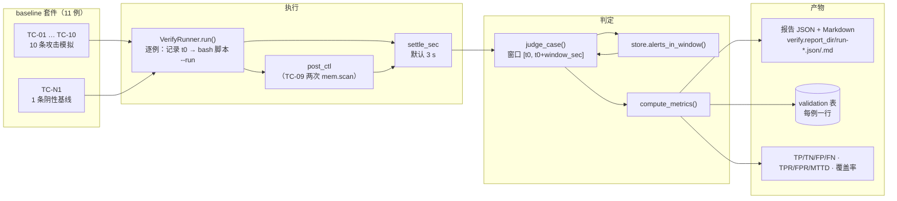

# 验证方法论与指标（verification）

> 本文说明 Hornwork 验证层的**用例设计、判定口径、指标定义、运行方式与扩展方法**。
> 所有命令、字段、路径均取自实际代码：`hornwork/verify/runner.py`、`judge.py`、
> `metrics.py`、`hornwork/cli.py`（`verify` 子命令）、`config.toml [verify]`、`docs/CONTRACT.md` §6。
>
> 核心思想：**不测"告警数量"，测"攻击行为是否被检出、正常行为是否被误报、检出有多快"**。
> 攻击模拟先在目标主机上产生真实系统行为（execve、文件落地、持久化、账号变更、注入等），
> 再由判定器在固定时间窗内查告警库，逐例给出 `TP / TN / FP / FN / inconclusive`。

## 1. 验证对象与总体流程



一次运行的完整时序：

1. `VerifyRunner.run()` 读 `[verify].suite`（默认 `baseline`），生成 `run_id`
   （`run-YYYYMMDD-HHMMSS`）；
2. 逐例执行：记录 `t0 = schema.utc_now()` → 若 `execute=True`，用
   `bash <script> --run` 在仓库根目录执行脚本（超时 `window_sec + 60` 秒，最小 30 s）；
3. 脚本成功后若有 `post_ctl`（当前只有 TC-09），通过 `ctl_call("mem.scan", ...)` 做后续
   控制面动作；
4. 等待 `settle_sec`（默认 3 s）让告警落库，再调 `judge_case(store, case, t0, window_sec)`；
5. 汇总 11 例结果 → `compute_metrics()` → 写 JSON + Markdown 报告到
   `[verify].report_dir`（默认 `/opt/hornwork/reports`），并把每例写入 `validation` 表。

## 2. 用例矩阵（baseline 套件）

套件定义在 `hornwork/verify/runner.py` 的 `BASELINE_CASES`；脚本随仓库分发在
`hornwork/verify/simulate/`（文件名与矩阵一一对应，契约见 §3）。**10 条攻击模拟 + 1 条阴性**：

| 用例 | 名称 | ATT&CK | 脚本 | 关键动作 | 主要验证点 |
|---|---|---|---|---|---|
| TC-01 | Unix Shell 命令执行 | T1059.004 | `T1059.004.sh` | `env /bin/sh -c 'id; uname -a'` | auditd `execve` / 主机规则 |
| TC-02 | 本地 HTTP 下载 EICAR 样本 | T1105 | `T1105.sh` | 本地 HTTP 下载 EICAR 到 `/tmp` | FIM + 级联静态扫描 + 告警 |
| TC-03 | 创建 systemd 服务单元 | T1543.002 | `T1543.002.sh` | 写入 `/etc/systemd/system/hornwork-tc03.service` 后精确删除 | 持久化检查 / FIM |
| TC-04 | 写入 cron 定时任务 | T1053.003 | `T1053.003.sh` | 写入 cron 测试任务并恢复 | 持久化检查 / 主机规则 |
| TC-05 | 创建本地账号 | T1136.001 | `T1136.001.sh` | `useradd` 测试账号并删除 | 账号异常检查 |
| TC-06 | 复制 `/etc/shadow` | T1003.008 | `T1003.008.sh` | 复制 `/etc/shadow` 到临时文件并删除 | 敏感文件访问规则 |
| TC-07 | C2 心跳外联（情报域名） | T1071.001 | `T1071.001.sh` | 发 3 个 IOC 域名 DNS 查询 + 本地 8080 心跳 10 次 | N-0103 情报域名 / N-0106 心跳（**任一命中即 TP**） |
| TC-08 | 本地端口扫描 | T1046 | `T1046.sh` | 扫 `127.0.0.1` 1–100 端口 | N-0101 SYN 扫描告警 |
| TC-09 | PTRACE 注入演示 | T1055.008 | `T1055.008.sh` | `inject_demo` 注入 nop | memscan 注入告警（A+B 判定） |
| TC-10 | LD_PRELOAD 劫持 | T1574.006 | `T1574.006.sh` | 写 `/etc/ld.so.preload` 并恢复 | LD_PRELOAD 后门检查 |
| TC-N1 | 正常基线操作（阴性） | — | `N-baseline.sh` | `ls` / `date` / `cat /etc/os-release` 等本地只读命令 | 阴性样本，用于 `FPR` |

用例字段（`BASELINE_CASES` 元素）：

| 字段 | 含义 |
|---|---|
| `case_id` | `TC-01` … `TC-10`、`TC-N1`，报告与 `validation` 表主键之一 |
| `name` | 中文名称（报告/CLI 展示） |
| `technique` | ATT&CK 技术编号；阴性用例为 `None` |
| `expected` | `alert_present`（应告警）或 `no_alert`（不应告警） |
| `rule_ids` | 规则线索；`judge` 按 **OR** 语义收窄（任一命中即相关），可为空 |
| `script` | 脚本文件名，相对 `verify.simulate_dir` |
| `post_ctl` | 可选，脚本成功后的控制面动作（TC-09 用两次 `mem.scan`） |

规则线索（`rule_ids`）当前取值：TC-07 为 `["N-0103","N-0106"]`，TC-08 为
`["N-0101","N-0102"]`，TC-09 为 `["M-0101"]`，其余为空（由 `technique` 兜底匹配）。

## 3. 模拟脚本契约（脚本随仓库分发）

**位置**：11 个脚本随仓库分发在 `hornwork/verify/simulate/`，文件名与 `BASELINE_CASES`
的 `script` 字段一一对应。运行时可按下列顺序定位：

1. `config.toml [verify].simulate_dir` 指向的目录（优先，便于用自有脚本替换）；
2. 未配置或目录不存在时，退回包内目录 `hornwork/verify/simulate/`（即 `PACKAGE_SIM_DIR`）。

脚本缺失或不可执行时，`VerifyRunner._execute_script()` 把该例标为 `inconclusive`
（`item["error"] = "脚本不存在：..."`），**不计入 TPR/FPR**。

契约要点（详见 `hornwork/verify/simulate/README.md`）：

- 统一 `set -euo pipefail`；开头打印 `TC-xx <technique> start`，结尾打印 `TC-xx done`；
- 支持 `--dry-run`（只打印计划动作）与 `--run`（runner 传入，等价默认执行）；
- 全部使用 `trap cleanup EXIT` 清理；危险动作（TC-05/06/10）前置检查 root/sudo 与可写性；
- 需要 root 但拿不到 `sudo -n` 时输出 `TC-xx SKIP: ...` 并 `exit 0`，runner 记为 `inconclusive`；
- 只做无害动作：TC-02 的 EICAR 是公开杀软测试串（非恶意代码）；TC-05/06/10 退出时精确恢复；
- 脚本可在 Linux 上执行；Windows 开发机建议用 `--no-execute` 走数据库判定路径
  （`execute=True` 时缺少 `bash` 会把用例记为 `inconclusive`）。

常用环境变量（脚本级，均有默认值，便于在不同主机调整）：`HORNWORK_TC02_PORT`、
`HORNWORK_TC05_USER`、`HORNWORK_TC07_TARGET/PORT/DNS_SERVER/DOMAINS/COUNT`、
`HORNWORK_TC08_TARGET/START/END`、`HORNWORK_TMP`、`HORNWORK_TC09_*`（KEEP/HOLD_SEC/
TARGET_SEC/PORT）、`HORNWORK_PYTHON`。

### 3.1 TC-09 的控制面联动

TC-09 是唯一带 `post_ctl` 的用例：

```json
{"method": "mem.scan", "pid_file": "hornwork-tc09.pid",
 "double_scan": true, "snapshot": true, "interval_sec": 1}
```

- runner 在 `ctl_call` 可用时以 `HORNWORK_TC09_KEEP=1` 运行脚本，脚本注入成功后保留
  目标进程与 `$HORNWORK_TMP/hornwork-tc09.pid`；
- runner 读 pid 文件，**连续两次** `ctl_call("mem.scan", ...)`：第一次建行为基线，
  间隔 1 s 后第二次带 `snapshot=true`，触发"10 s 内新连接"条件 B，让 memscan 的
  A（匿名 RWX/memfd）+ B（行为）判定成立并产生 T1055 告警；
- 第二次结果写入报告 `cases[].post_ctl`（同时保留 `baseline` 供排查），随后 runner
  清理目标进程与 pid 文件，再等 `settle_sec` 判定。

`ctl_call` 为空（离线 / 无 daemon / 非 root 且 daemon 不可用）时跳过 `mem.scan`，
脚本按默认 `KEEP=0` 自行清理。

## 4. 判定器：时间窗匹配

`hornwork/verify/judge.py` 的口径：

- **时间窗**：用例启动前采样 `t0`，窗口为 `[t0, t0 + window_sec]`（`window_sec` 取
  `[verify].window_sec`，默认 60 s；JSON 报告里记录了实际值），两端都包含；
- **expected 与 verdict**：

| expected | 窗口内有相关告警 | 窗口内无相关告警 |
|---|---|---|
| `alert_present` | `TP`（真阳性） | `FN`（漏报） |
| `no_alert` | `FP`（误报） | `TN`（真阴性） |

- **"相关告警"的过滤**（三步，依次收窄/兜底）：
  1. 用例给出 `rule_ids` 时先按 `rule_id IN (...)` 查询，**任一规则命中即相关**
     （OR 语义，TC-07 命中 N-0103 或 N-0106 都算 TP）；
  2. `technique` 在 Python 侧再过滤：告警 `technique` 字段、`mitre.techniques`、
     `rule.mitre` 三处都算，支持**父子技术互认**（`T1055` ↔ `T1055.008`，用前缀判断）；
  3. 规则 ID 随规则库版本调整后可能查不到：若按 `rule_ids` 无结果且用例带
     `technique`，再按技术口径做一次兜底召回（只服务"应告警"用例，阴性用例不带
     `technique`，不受影响）。
- **MTTD**：`mttd_sec = 首个相关告警 ts − t0`，四舍五入到整数秒，负数按 0；
  只对 `TP` 计入均值。
- **inconclusive 的情况**：期望值非法、时间不可解析、告警查询异常、脚本缺失/超时/
  返回码非 0/输出含 `SKIP` 标记——观测值可以保留，但**判定不计入 TPR/FPR**。

> 去重注意：`alert` 表有唯一索引 `uq_alert_dedup(dedup_key, substr(ts,1,16))`，
> 同一规则、同一实体、同一分钟内只保留一条；进程类告警的 `dedup_key` 含 `pid`，
> 因此"同一分钟两次 `useradd`"仍是两条告警，不会互相吞掉（用例依赖此语义）。

## 5. 指标定义

`hornwork/verify/metrics.py` 的 `compute_metrics(rows)` 对 `validation` 行或
`judge_case()` 结果统一汇总：

| 指标 | 公式/定义 | 说明 |
|---|---|---|
| `TP` | 计数 | 应告警且告警 |
| `TN` | 计数 | 不应告警且未告警 |
| `FP` | 计数 | 不应告警却告警 |
| `FN` | 计数 | 应告警但漏报 |
| `inconclusive` | 计数 | 脚本失败/跳过/判定异常，不计入比率 |
| `TPR` | `TP / (TP + FN)` | 真阳性率（检出率）；无正样本时为 `null` |
| `FPR` | `FP / (FP + TN)` | 假阳性率；无阴性样本时为 `null` |
| `mttd_sec` | `mean(TP 用例的 mttd_sec)` | 平均检出时延，保留 2 位小数；无 TP 样本为 `null` |
| `coverage` | `有 TP 的技术数 / 用例涉及的技术数` | 技术覆盖率；分母为 0 时为 `null` |
| `techniques` | 列表 | 用例涉及的 ATT&CK 技术编号（去重保序） |

约定：**分母为 0 的比率返回 `None`（JSON 里是 `null`），不伪造 0**。
`metrics_from_validation(rows)` 会从 `validation.payload` 补齐 `technique` / `mttd_sec`
后再复用 `compute_metrics()`。

## 6. 如何运行

### 6.1 前置条件

- Linux 目标主机，仓库根目录可访问（脚本以仓库根为工作目录，TC-09 需能找到
  `hornwork/tools/inject_demo.c`）；
- daemon 正在运行（推荐）：`systemctl status hornwork`；控制面 socket 存在；
- 规则已加载：`hornworkctl rules reload`（或 `make rules`）；
- 11 个模拟脚本已按 §3 的契约放到 `[verify].simulate_dir` 或包内 `simulate/`；
- 时间同步：MTTD 依赖 UTC 时间一致（`[verify].clock_skew_max_sec`，默认 2 s）。

### 6.2 命令

```bash
# 以 root 运行：验证器在 CLI 进程内直接执行脚本（可跑需要 root 的用例），
# 仅 mem.scan 借用 daemon / 本地 MemoryScanner
sudo hornworkctl verify run

# 非 root 且 daemon 在线：交给 daemon 执行；需要 root 的用例会 SKIP → inconclusive
hornworkctl verify run

# 强制交给 daemon（即使当前是 root）
hornworkctl verify run --remote

# 只做数据库判定、不执行脚本（无 root / 演示 / 回归已有告警）
hornworkctl verify run --no-execute

# JSON 输出（脚本化/CI 用）
hornworkctl --json verify run --suite baseline
```

```bash
# 也可以直接用 Python 入口（venv 内，等价于 hornworkctl 的本地路径）
/opt/hornwork-venv/bin/python -m hornwork.cli verify run
```

> 为什么 root 时在 CLI 进程内跑：TC-03/04/05/06/10 需要写 `/etc`、`useradd` 等，
> 而 daemon 以 `hornwork` 用户运行；若经控制面转给 daemon，这些用例只能 SKIP。
> 因此 `cli.cmd_verify()` 在 `geteuid()==0` 且未指定 `--remote` 时，用
> `VerifyRunner(store, cfg, ctl_call=...)` 在本进程执行，`mem.scan` 也由本地
> `MemoryScanner` 完成（避免 Yama/权限导致的 `/proc/pid/mem` 读取失败）。

### 6.3 产物与查看

| 产物 | 位置/方式 |
|---|---|
| JSON 报告 | `[verify].report_dir/<run_id>.json` |
| Markdown 摘要 | `[verify].report_dir/<run_id>.md` |
| 逐例结果 | `validation` 表（`run_id, case_id, technique, expected, observed, verdict, mttd_sec, payload`） |
| 最新报告 | `GET /api/validate`（Web 控制台） |
| 控制面 | `verify.run` 方法（`{suite, execute}`） |

CLI 非 `--json` 时会打印报告路径、逐例表格和一行汇总：

```text
TP=10 TN=1 FP=0 FN=0 inconclusive=0 TPR=1.0 FPR=0.0 MTTD=0.5s 覆盖率=1.0
```

## 7. 参考基准

一次干净数据库、脚本与依赖齐备、规则库按默认配置加载的完整运行，参考基准为：

| 指标 | 参考值 | 说明 |
|---|---|---|
| `TP` | 10 | 10 条攻击模拟全部检出 |
| `TN` | 1 | 阴性基线未误报 |
| `FP` | 0 | 无假阳性 |
| `FN` | 0 | 无漏报 |
| `TPR` | 1.0 | 10 / (10 + 0) |
| `FPR` | 0.0 | 0 / (0 + 1) |
| `MTTD` | ≈ 0.5 s | 首条告警相对 `t0` 的均值（整数秒采样） |
| `coverage` | 1.0 | 10 个技术全部有 TP 命中 |

注意事项：

- 这些数值是**参考基准**，不是硬编码：干净库/脏库、规则库版本、主机性能、是否 root、
  端口占用、脚本 SKIP 都会影响结果；`inconclusive` 的用例不计入 TPR/FPR。
- 阴性用例（TC-N1）在部分环境下可能触发通用侦察类规则而变成 `FP`——这是需要排查的
  真实误报（规则过宽或基线命令不合适），不是"指标不达标"的借口。
- 若规则 ID 调整，先按 `rule_ids` 收窄失败会走技术兜底；若技术编号也变了，用例本身
  需要同步更新（见 §8）。

## 8. 如何新增用例

新增一个 ATT&CK 覆盖点，按以下顺序改：

1. **写脚本**：在 `[verify].simulate_dir`（或包内 `simulate/`）下新建
   `T<技术号>.sh`，严格遵守 §3 契约（`--dry-run`/`--run`、`trap` 清理、`SKIP` 语义、
   只做无害动作，结束打印 `TC-xx done`）；
2. **加入套件**：在 `hornwork/verify/runner.py` 的 `BASELINE_CASES` 追加一条 dict：

   ```python
   {
       "case_id": "TC-11",
       "name": "中文名称",
       "technique": "T####.###",
       "expected": "alert_present",      # 或 "no_alert"
       "rule_ids": ["N-01xx"],           # 可空；多个按 OR
       "script": "T####.###.sh",
       # 可选：脚本成功后的控制面动作
       # "post_ctl": {"method": "mem.scan", "pid_file": "...", "double_scan": True,
       #              "snapshot": True, "interval_sec": 1},
   }
   ```

3. **同步文档**：更新本文件 §2 用例矩阵与 `hornwork/verify/simulate/README.md`
   的矩阵/环境变量说明；
4. **校准规则线索**：用 `tools/tune_verify.sh` 逐个执行脚本并打印该时刻之后新增的
   告警（它按 `t0` 过滤 `hornworkctl --json alerts`），据此填 `rule_ids`；
5. **跑回归**：`sudo hornworkctl verify run`，确认新用例不是 `inconclusive`，且
   原有 11 例没有被破坏；
6. **单测**：验证/Web 相关单测在 `tests/test_verify_web.py`，`judge`/`metrics` 的
   纯函数用例也在其中；提交前跑 `python -m unittest tests.test_verify_web -v`。

## 9. 常见失败与排查

| 现象 | 常见原因 | 处理 |
|---|---|---|
| 多数用例 `inconclusive`，`error="脚本不存在"` | 模拟脚本未提供 / `[verify].simulate_dir` 配置错误 | 按 §3 放脚本；检查 `simulate_dir` 是否存在、文件名大小写 |
| 需要 root 的用例 `SKIP` | 非 root 且走 daemon 执行 | `sudo hornworkctl verify run` 或补齐 `sudo -n` 权限 |
| 用例 `FN`（应告警未告警） | 规则未加载 / 采集器未运行 / 窗口过短 | `hornworkctl status`、`rules reload`、检查 `[verify].window_sec` 与 `settle_sec` |
| 阴性用例 `FP` | 规则过宽（如 `apt update` 命中通用侦察规则） | 收窄规则或换更纯的基线命令；不要靠改判定器"修指标" |
| MTTD 异常大 | 主机时间不同步 / 告警延迟落库 | `timedatectl`、`chronyc tracking`；必要时增大 `settle_sec` |
| TC-09 无告警 | 注入失败（ptrace 权限）/ 目标进程提前退出 | 看报告 `cases[].stdout_tail`、`post_ctl.error`；检查 `kernel.yama.ptrace_scope` 与 `gcc` |
| 报告/验证结果写入失败 | `[verify].report_dir` 不可写 | 检查目录权限（`/opt/hornwork/reports`），或改配置到可写目录 |
| `--no-execute` 也全是 `FN` | 数据库里没有对应时间窗的告警 | 该模式只做 DB 判定，需要先有真实告警（演示/回归用） |

## 10. 与其他文档的关系

| 文档 | 关系 |
|---|---|
| `docs/CONTRACT.md` §6 | `judge_case` / `compute_metrics` / `VerifyRunner` / `Forensics` 的接口签名 |
| `docs/interfaces.md` | 控制面 `verify.run`、Web `/api/validate`、`validation` 表字段 |
| `hornwork/verify/simulate/README.md` | 模拟脚本的**唯一契约**（用例矩阵、脚本规范、环境变量、TC-09 联动） |
| `docs/architecture.md` | 验证层在整体架构中的位置与数据流 |
